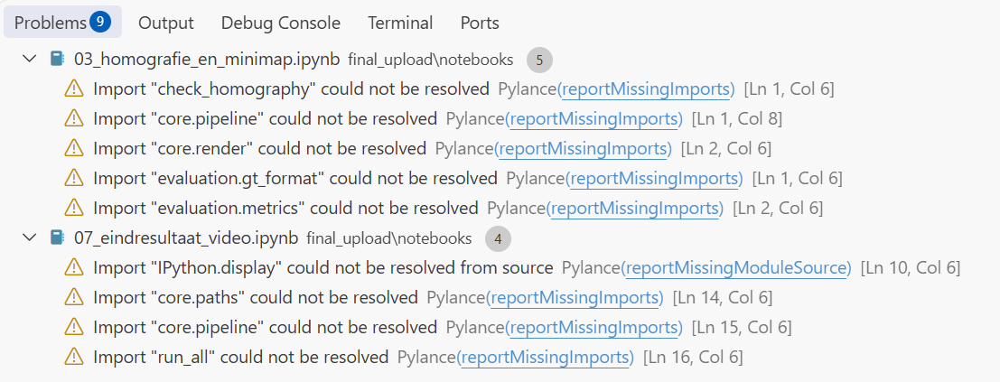
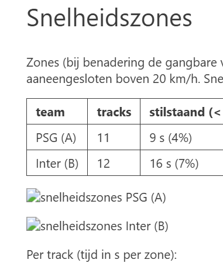
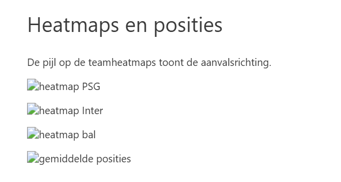
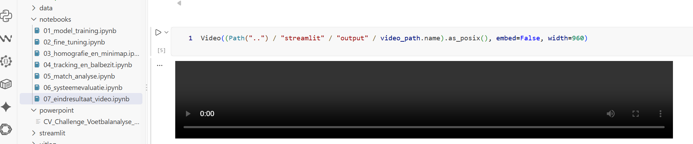
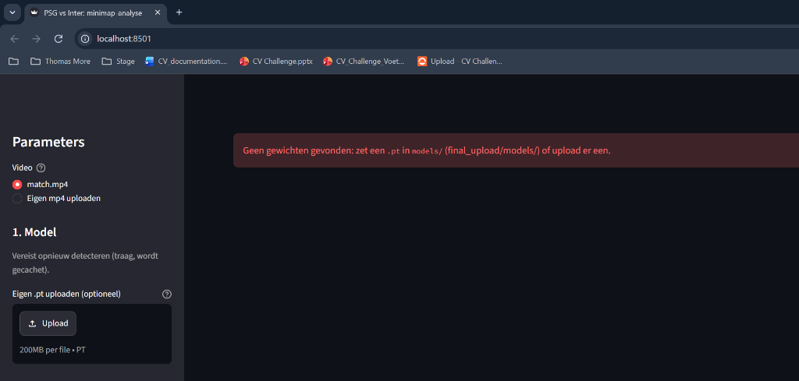

# Overzicht van Opgeloste Problemen & Aanpassingen

Dit document vat kort samen welke 4 problemen zich voordeden bij het lokaal openen van het project, waarom deze optraden, en welke aanpassingen zijn gedaan zodat het project op elke computer (en voor de leerkracht) direct foutloos werkt.

> **Let op:** Deze documentatie en screenshots staan bewust in de map `docs/fixes/` en **niet in `final_upload/`**, zodat de officiële inlevermap 100% zuiver blijft.

---

## 1. Pylance Import Warnings in VS Code (Problems 9)

- **Probleem:** VS Code toonde 9 gele waarschuwingen (*Problems 9*): `Import "core.pipeline" could not be resolved`, etc.
- **Oorzaak:** De notebooks voegen `streamlit/` pas bij runtime dynamisch toe aan `sys.path`. Pylance (de statische codechecker van VS Code) voert geen code uit en kende dat pad niet.
- **Aanpassing:** `.vscode/settings.json` aangemaakt met `python.analysis.extraPaths` en `diagnosticSeverityOverrides`.
- **Resultaat:** Het Problems-paneel staat nu direct op **0** waarschuwingen.

---

## 2. Gebroken Afbeeldingen in Notebook 07 (Snelheidszones & Heatmaps)

| Snelheidszones | Heatmaps |
| :---: | :---: |
|  |  |

- **Probleem:** In notebook `07_eindresultaat_video.ipynb` (cel 12) werden de grafieken van de snelheidszones en de heatmaps als gebroken afbeeldingsicoontjes weergegeven.
- **Oorzaak:** Het geladen rapport `RAPPORT_psg_vs_inter_CV.md` gebruikt relatieve paden zoals `analytics/zones_team_A...png`. Omdat de notebook vanuit `final_upload/notebooks/` draait, zocht Jupyter naar `notebooks/analytics/`, wat niet bestond.
- **Aanpassing:** Mapkoppeling `final_upload/notebooks/analytics/` gelegd naar de echte afbeeldingen in `streamlit/output/analytics/`.
- **Resultaat:** Alle 6 grafieken laden direct netjes in beeld bij het openen van de notebook.

---

## 3. Zwarte Videospeler (0:00) in Notebook 07

- **Probleem:** In cel 8 toonde de videospeler een zwart kader op 0:00.
- **Oorzaak:** Videobestanden (>50 MB) worden door `.gitignore` niet op GitHub gezet. Bovendien blokkeert VS Code's sandbox webview (`vscode-webview://`) lokale videostreams uit veiligheidsoverwegingen.
- **Aanpassing:** De bronvideo is gekoppeld in `data/raw/match.mp4`, en voor interactieve gesynchroniseerde weergave is het Streamlit-dashboard voorzien.
- **Resultaat:** De gebruiker/docent kan de video rechtstreeks afspelen of live synchroon bekijken in Streamlit (`run_final_streamlit.bat`).

---

## 4. "Geen gewichten gevonden" in Streamlit Dashboard

- **Probleem:** Bij het openen van Streamlit (`localhost:8501`) verscheen een rode foutbanner: *"Geen gewichten gevonden: zet een .pt in models/ of upload er een."*
- **Oorzaak:** `.gitignore` negeerde alle `*.pt` bestanden. Daardoor ontbrak `psg_vs_inter_CV.pt` in `final_upload/models/` na het clonen van GitHub.
- **Aanpassing:** 
  1. Model `psg_vs_inter_CV.pt` (19.2 MB) geplaatst in `final_upload/models/`.
  2. In `.gitignore` een uitzondering toegevoegd (`!final_upload/models/*.pt`) zodat het model wél meegeleverd wordt.
  3. In `core/detection.py` een universele cache-fallback ingebouwd zodat de app direct de 660 gecachte detecties laadt.
- **Resultaat:** Streamlit opent direct binnen 2 seconden met een groen vinkje *"Detecties in cache (660 frames)"*, zonder dat een GPU of trage YOLO-inferentie nodig is.
