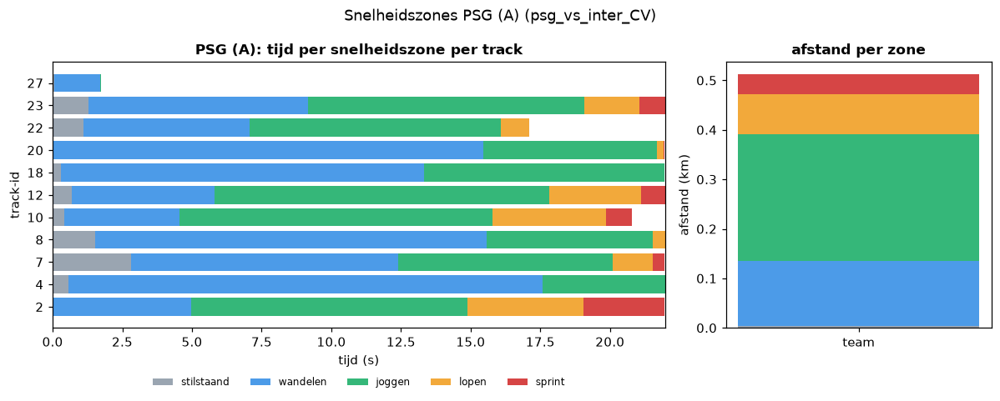
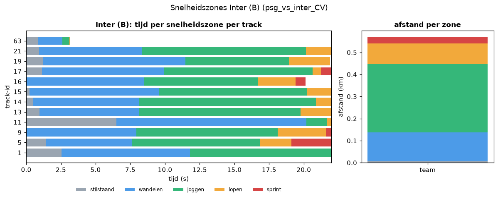

# Match analytics (psg_vs_inter_CV)

Clip: 22.0 s, 660 processed frames, 29 tracks of at least 1.0 s.
Positions smoothed with a 0.5 s centred moving average (no smoothing across gaps > 0.5 s).

## Per team
| team | n_tracks | total_distance_m | mean_distance_m | mean_kmh | max_kmh |
|---|---|---|---|---|---|
| A | 11 | 511.5 | 46.5 | 8.11 | 31.2 |
| B | 12 | 569.6 | 47.5 | 8.27 | 24.8 |

## Per track
| track_id | group | team | n_frames | duration_s | distance_m | mean_kmh | max_kmh |
|---|---|---|---|---|---|---|---|
| 1 | player_B | B | 660 | 21.97 | 39.0 | 6.39 | 11.6 |
| 2 | player_A | A | 657 | 21.97 | 79.3 | 12.99 | 31.2 |
| 3 | referee | - | 500 | 16.63 | 26.5 | 5.74 | 13.9 |
| 4 | player_A | A | 660 | 21.97 | 35.9 | 5.89 | 12.4 |
| 5 | player_B | B | 660 | 21.97 | 65.5 | 10.74 | 23.0 |
| 6 | referee | - | 651 | 21.97 | 53.0 | 8.69 | 20.1 |
| 7 | player_A | A | 653 | 21.97 | 42.7 | 7.0 | 20.3 |
| 8 | player_A | A | 660 | 21.97 | 37.5 | 6.14 | 16.1 |
| 9 | player_B | B | 660 | 21.97 | 62.4 | 10.22 | 24.8 |
| 10 | player_A | A | 625 | 20.8 | 63.9 | 11.06 | 21.7 |
| 11 | player_B_goal_keeper | B | 660 | 21.97 | 26.6 | 4.36 | 17.3 |
| 12 | player_A | A | 660 | 21.97 | 71.7 | 11.76 | 28.8 |
| 13 | player_B | B | 658 | 21.97 | 55.2 | 9.05 | 17.5 |
| 14 | player_B | B | 660 | 21.97 | 49.6 | 8.13 | 17.5 |
| 15 | player_B | B | 660 | 21.97 | 54.6 | 8.94 | 17.7 |
| 16 | player_B | B | 570 | 20.13 | 53.6 | 9.58 | 21.9 |
| 17 | player_B | B | 660 | 21.97 | 51.3 | 8.4 | 24.6 |
| 18 | player_A | A | 660 | 21.97 | 40.2 | 6.59 | 14.5 |
| 19 | player_B | B | 658 | 21.9 | 50.4 | 8.28 | 19.2 |
| 20 | player_A | A | 660 | 21.97 | 38.6 | 6.32 | 15.7 |
| 21 | player_B | B | 660 | 21.97 | 56.2 | 9.2 | 19.5 |
| 22 | player_A | A | 514 | 17.1 | 42.5 | 8.95 | 17.0 |
| 23 | player_A | A | 660 | 21.97 | 57.7 | 9.45 | 23.7 |
| 24 | referee | - | 341 | 11.33 | 11.1 | 3.51 | 7.7 |
| 25 | referee | - | 180 | 5.97 | 3.2 | 1.94 | 4.3 |
| 27 | player_A | A | 42 | 1.73 | 1.5 | 3.07 | 4.2 |
| 51 | referee | - | 146 | 4.87 | 18.3 | 13.53 | 20.5 |
| 63 | player_B | B | 95 | 3.17 | 5.2 | 5.96 | 10.1 |
| 74 | referee | - | 34 | 1.1 | 5.9 | 19.26 | 20.7 |

## Possession
- Frames with possession: 479 of 660
- Share team A: 92%, team B: 8%
- Possession changes: 3

## Snelheidszones
Zones (bij benadering de gangbare voetbaldrempels; er is geen officiële standaard): stilstaand < 2 km/h, wandelen 2-7 km/h, joggen 7-15 km/h, lopen 15-20 km/h, sprint > 20 km/h. Een sprint = minstens 1 s aaneengesloten boven 20 km/h. Snelheid uit afgevlakte posities per stap.

| team | tracks | stilstaand (< 2 km/h) | wandelen (2-7 km/h) | joggen (7-15 km/h) | lopen (15-20 km/h) | sprint (> 20 km/h) | afstand sprint (m) | sprints |
|---|---|---|---|---|---|---|---|---|
| PSG (A) | 11 | 9 s (4%) | 99 s (46%) | 85 s (40%) | 17 s (8%) | 6 s (3%) | 39.9 | 2 |
| Inter (B) | 12 | 16 s (7%) | 98 s (40%) | 105 s (43%) | 19 s (8%) | 5 s (2%) | 29.2 | 2 |

Per track (tijd in s per zone):

| track_id | team | time_standing_s | time_walking_s | time_jogging_s | time_running_s | time_sprinting_s | n_sprints |
|---|---|---|---|---|---|---|---|
| 1 | B | 2.53 | 9.27 | 10.17 | 0.0 | 0.0 | 0 |
| 2 | A | 0.0 | 4.96 | 9.93 | 4.17 | 2.9 | 2 |
| 3 | - | 5.77 | 4.6 | 6.27 | 0.0 | 0.0 | 0 |
| 4 | A | 0.57 | 17.0 | 4.4 | 0.0 | 0.0 | 0 |
| 5 | B | 1.4 | 6.2 | 9.23 | 2.27 | 2.87 | 2 |
| 6 | - | 1.2 | 10.74 | 5.17 | 4.8 | 0.07 | 0 |
| 7 | A | 2.8 | 9.6 | 7.7 | 1.43 | 0.43 | 0 |
| 8 | A | 1.53 | 14.04 | 5.97 | 0.43 | 0.0 | 0 |
| 9 | B | 0.0 | 7.93 | 10.2 | 3.47 | 0.37 | 0 |
| 10 | A | 0.43 | 4.13 | 11.23 | 4.07 | 0.93 | 0 |
| 11 | B | 6.5 | 13.7 | 1.44 | 0.33 | 0.0 | 0 |
| 12 | A | 0.7 | 5.1 | 12.03 | 3.27 | 0.87 | 0 |
| 13 | B | 0.97 | 7.17 | 11.63 | 2.2 | 0.0 | 0 |
| 14 | B | 0.5 | 7.63 | 12.73 | 1.1 | 0.0 | 0 |
| 15 | B | 0.23 | 9.33 | 10.67 | 1.73 | 0.0 | 0 |
| 16 | B | 0.0 | 8.5 | 8.17 | 2.73 | 0.73 | 0 |
| 17 | B | 1.13 | 8.8 | 10.7 | 0.6 | 0.73 | 0 |
| 18 | A | 0.3 | 13.03 | 8.63 | 0.0 | 0.0 | 0 |
| 19 | B | 1.2 | 10.26 | 7.47 | 2.97 | 0.0 | 0 |
| 20 | A | 0.03 | 15.43 | 6.23 | 0.23 | 0.03 | 0 |
| 21 | B | 0.93 | 7.4 | 11.83 | 1.8 | 0.0 | 0 |
| 22 | A | 1.1 | 5.97 | 9.0 | 1.03 | 0.0 | 0 |
| 23 | A | 1.3 | 7.87 | 9.9 | 1.97 | 0.93 | 0 |
| 24 | - | 4.33 | 6.47 | 0.53 | 0.0 | 0.0 | 0 |
| 25 | - | 3.77 | 2.2 | 0.0 | 0.0 | 0.0 | 0 |
| 27 | A | 0.07 | 1.63 | 0.03 | 0.0 | 0.0 | 0 |
| 51 | - | 0.0 | 1.1 | 2.07 | 1.43 | 0.27 | 0 |
| 63 | B | 0.83 | 1.77 | 0.5 | 0.07 | 0.0 | 0 |
| 74 | - | 0.0 | 0.03 | 0.0 | 0.77 | 0.3 | 0 |

## Kilometers
| team | tracks | totaal km (ondergrens) | gem. km per track | km per speler per 90 min (indicatief) | cliplengte (s) |
|---|---|---|---|---|---|
| PSG (A) | 11 | 0.511 | 0.046 | 12.2 | 22.0 |
| Inter (B) | 12 | 0.57 | 0.047 | 12.4 | 22.0 |

Dit is een **ondergrens**: een ID-switch splitst een speler over meerdere tracks, tracks korter dan de minimumduur vallen weg en een speler telt alleen mee zolang hij getrackt wordt. De waarde per 90 minuten schaalt de afstandsratio van een clip van 22 s op en is **alleen indicatief**: een korte clip zegt weinig over een hele wedstrijd.

## Aanvalsrichting en aanvallen
- **PSG valt aan richting rechter doel (x=105)**; Inter valt aan richting linker doel (x=0).
- Betrouwbaarheid: **hoog** (3 van 3 signalen eens).
- Keepers (gem. x in m): {'B': 100.9} -> signaal +1
- Gemiddelde x veldspelers (m): {'A': 74.9, 'B': 81.4} -> signaal +1 (zwak bewijs)
- Netto balverplaatsing in x bij balbezit (m): {'A': 18.8, 'B': 9.3} -> signaal +1
- Signaal +1 = PSG valt naar rechts aan (x=105), -1 = naar links (x=0), 0 = geen uitspraak; de keeper telt dubbel.

| team | balbezitfases | ingangen laatste derde | aanvallen | ingangen 16 m-gebied |
|---|---|---|---|---|
| PSG (A) | 5 | 5 | 5 | 4 |
| Inter (B) | 2 | 0 | 0 | 0 |

Aanval = balbezitsfase waarin de bal het laatste derde (binnen 35 m van de aangevallen doellijn) binnenkomt; ingang 16 m-gebied = bal in het strafschopgebied (16,5 m x 40,3 m). **Schoten** zijn bewust niet geteld: ze zijn in deze trackingdata niet betrouwbaar van passes te onderscheiden.

## Figures
- heatmap_team_A_psg_vs_inter_CV.png, heatmap_team_B_psg_vs_inter_CV.png, heatmap_ball_psg_vs_inter_CV.png (team heatmaps with the attacking direction as arrow)
- average_positions_psg_vs_inter_CV.png
- zones_team_A_psg_vs_inter_CV.png, zones_team_B_psg_vs_inter_CV.png

## Beperkingen
- Homography noise makes positions jitter; we smooth, but a raw (unsmoothed) speed would be inflated.
- Speeds are estimates, not true speeds: max speed is capped at 36 km/h
  (0 track(s) hit the cap, which points to a tracking/homography artefact).
- The clip is short, so distances cover seconds, not a match; average positions are not a real formation.
- ID switches split a player's distance over several track ids, so per-track distance is a lower bound
  per player and the number of tracks can exceed 22.
- Speed zones, sprints, kilometres and attack counts inherit these limits; the attacking direction is a vote of
  three signals (see above) and shots are not counted.
