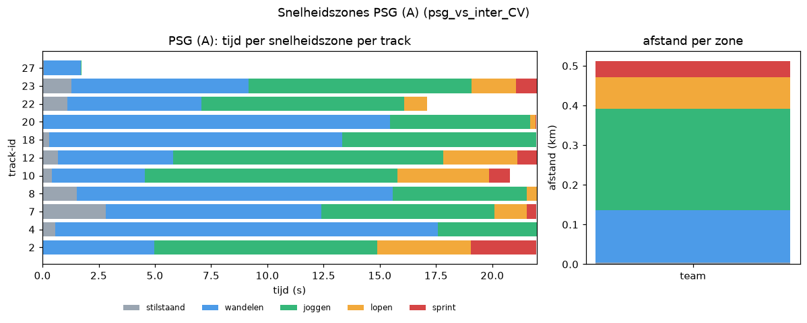
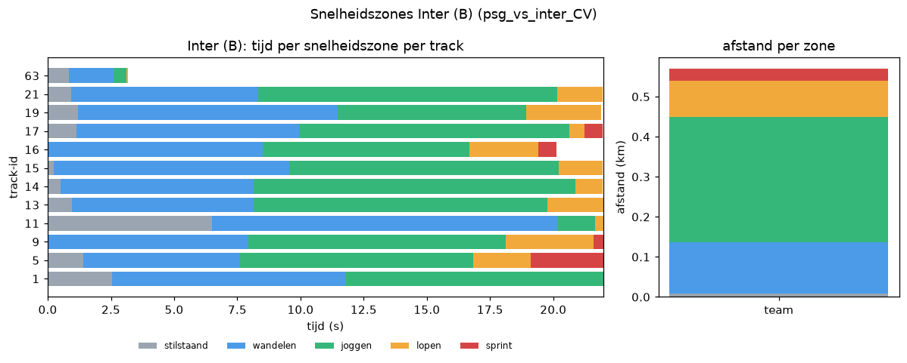
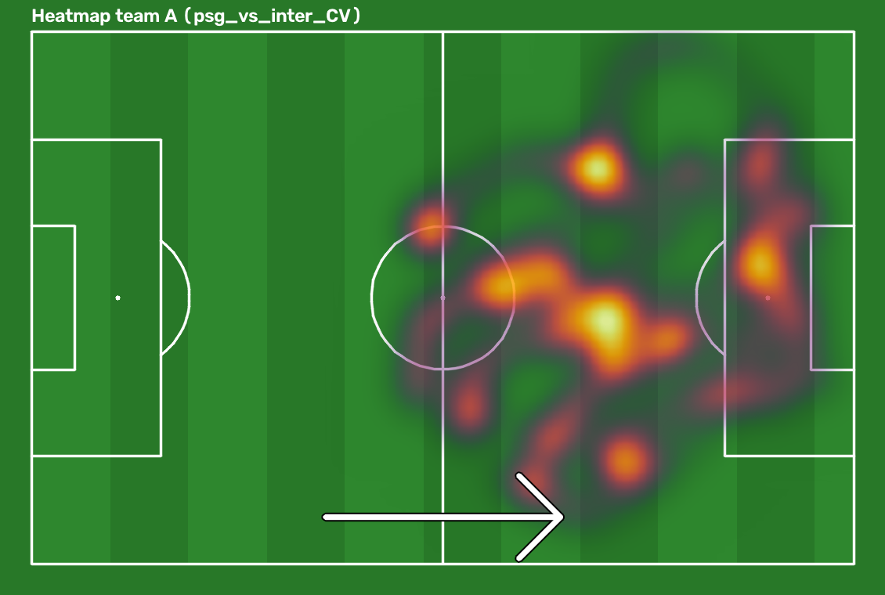
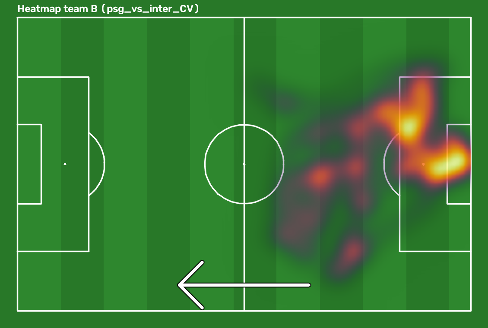
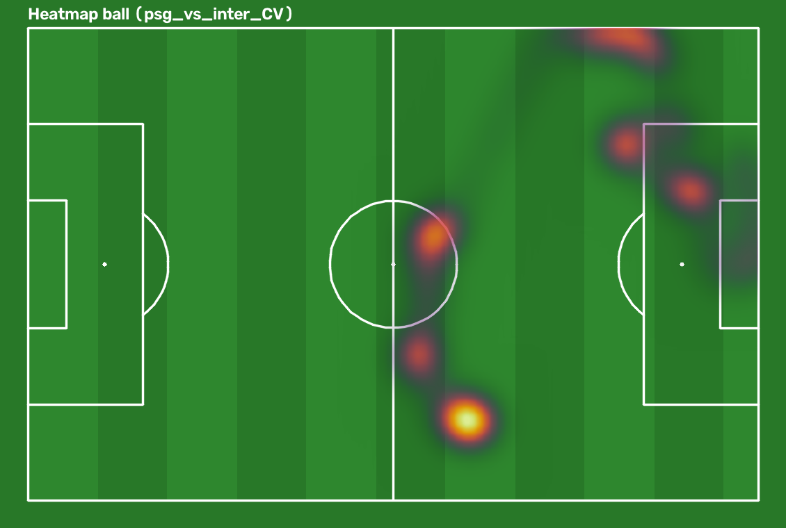
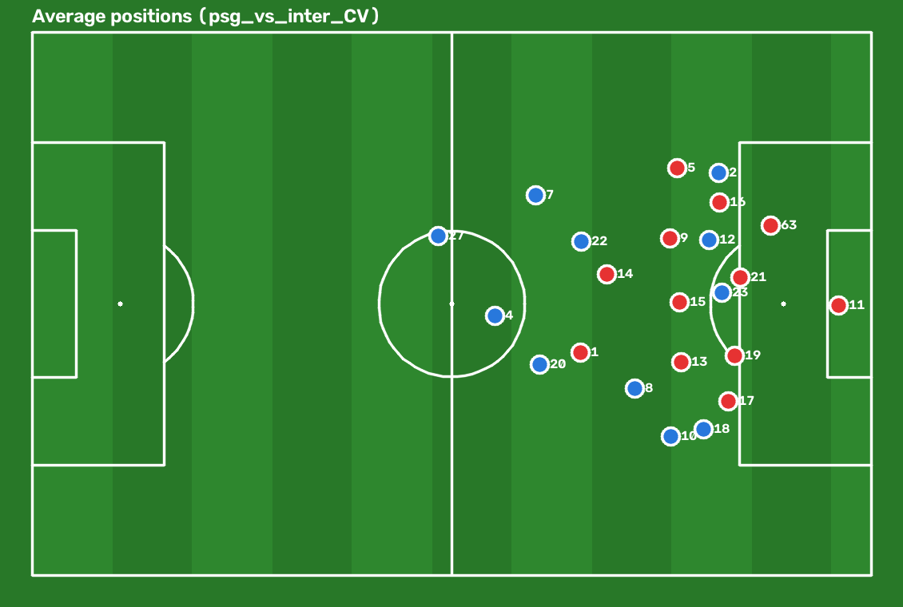

# Rapport wedstrijdanalyse (psg_vs_inter_CV)

## Samenvatting
- Clip: 22.0 s, 660 verwerkte frames, 29 tracks van minstens 1 s.
- Balbezit: PSG 92%, Inter 8%, 3 wissels.
- PSG valt aan richting rechter doel (x=105) (betrouwbaarheid hoog).
- Aanvallen (bal in laatste derde): PSG 5, Inter 0; ingangen 16 m-gebied: PSG 4, Inter 0.
- Totaal gelopen (ondergrens): PSG 0.51 km, Inter 0.57 km.

Gegenereerd met `run_all.py` (gewichten psg_vs_inter_CV.pt, imgsz 1280, stride 1).

## Balbezit
- Frames met balbezit: 479 van 660
- Aandeel PSG (A): 92%, Inter (B): 8%; wissels: 3

## Afstand en snelheid per team

| team | n_tracks | total_distance_m | mean_distance_m | mean_kmh | max_kmh |
|---|---|---|---|---|---|
| PSG (A) | 11 | 511.5 | 46.5 | 8.11 | 31.2 |
| Inter (B) | 12 | 569.6 | 47.5 | 8.27 | 24.8 |

Per track: zie `analytics/players_psg_vs_inter_CV.csv`.

## Snelheidszones
Zones (bij benadering de gangbare voetbaldrempels; er is geen officiële standaard): stilstaand < 2 km/h, wandelen 2-7 km/h, joggen 7-15 km/h, lopen 15-20 km/h, sprint > 20 km/h. Een sprint = minstens 1 s aaneengesloten boven 20 km/h. Snelheid uit afgevlakte posities per stap.

| team | tracks | stilstaand (< 2 km/h) | wandelen (2-7 km/h) | joggen (7-15 km/h) | lopen (15-20 km/h) | sprint (> 20 km/h) | afstand sprint (m) | sprints |
|---|---|---|---|---|---|---|---|---|
| PSG (A) | 11 | 9 s (4%) | 99 s (46%) | 85 s (40%) | 17 s (8%) | 6 s (3%) | 39.9 | 2 |
| Inter (B) | 12 | 16 s (7%) | 98 s (40%) | 105 s (43%) | 19 s (8%) | 5 s (2%) | 29.2 | 2 |

Per track (tijd in s per zone):

| track_id | team | time_standing_s | time_walking_s | time_jogging_s | time_running_s | time_sprinting_s | n_sprints |
|---|---|---|---|---|---|---|---|
| 1 | B | 2.53 | 9.27 | 10.17 | 0.0 | 0.0 | 0 |
| 2 | A | 0.0 | 4.96 | 9.93 | 4.17 | 2.9 | 2 |
| 3 | - | 5.77 | 4.6 | 6.27 | 0.0 | 0.0 | 0 |
| 4 | A | 0.57 | 17.0 | 4.4 | 0.0 | 0.0 | 0 |
| 5 | B | 1.4 | 6.2 | 9.23 | 2.27 | 2.87 | 2 |
| 6 | - | 1.2 | 10.74 | 5.17 | 4.8 | 0.07 | 0 |
| 7 | A | 2.8 | 9.6 | 7.7 | 1.43 | 0.43 | 0 |
| 8 | A | 1.53 | 14.04 | 5.97 | 0.43 | 0.0 | 0 |
| 9 | B | 0.0 | 7.93 | 10.2 | 3.47 | 0.37 | 0 |
| 10 | A | 0.43 | 4.13 | 11.23 | 4.07 | 0.93 | 0 |
| 11 | B | 6.5 | 13.7 | 1.44 | 0.33 | 0.0 | 0 |
| 12 | A | 0.7 | 5.1 | 12.03 | 3.27 | 0.87 | 0 |
| 13 | B | 0.97 | 7.17 | 11.63 | 2.2 | 0.0 | 0 |
| 14 | B | 0.5 | 7.63 | 12.73 | 1.1 | 0.0 | 0 |
| 15 | B | 0.23 | 9.33 | 10.67 | 1.73 | 0.0 | 0 |
| 16 | B | 0.0 | 8.5 | 8.17 | 2.73 | 0.73 | 0 |
| 17 | B | 1.13 | 8.8 | 10.7 | 0.6 | 0.73 | 0 |
| 18 | A | 0.3 | 13.03 | 8.63 | 0.0 | 0.0 | 0 |
| 19 | B | 1.2 | 10.26 | 7.47 | 2.97 | 0.0 | 0 |
| 20 | A | 0.03 | 15.43 | 6.23 | 0.23 | 0.03 | 0 |
| 21 | B | 0.93 | 7.4 | 11.83 | 1.8 | 0.0 | 0 |
| 22 | A | 1.1 | 5.97 | 9.0 | 1.03 | 0.0 | 0 |
| 23 | A | 1.3 | 7.87 | 9.9 | 1.97 | 0.93 | 0 |
| 24 | - | 4.33 | 6.47 | 0.53 | 0.0 | 0.0 | 0 |
| 25 | - | 3.77 | 2.2 | 0.0 | 0.0 | 0.0 | 0 |
| 27 | A | 0.07 | 1.63 | 0.03 | 0.0 | 0.0 | 0 |
| 51 | - | 0.0 | 1.1 | 2.07 | 1.43 | 0.27 | 0 |
| 63 | B | 0.83 | 1.77 | 0.5 | 0.07 | 0.0 | 0 |
| 74 | - | 0.0 | 0.03 | 0.0 | 0.77 | 0.3 | 0 |

## Kilometers
| team | tracks | totaal km (ondergrens) | gem. km per track | km per speler per 90 min (indicatief) | cliplengte (s) |
|---|---|---|---|---|---|
| PSG (A) | 11 | 0.511 | 0.046 | 12.2 | 22.0 |
| Inter (B) | 12 | 0.57 | 0.047 | 12.4 | 22.0 |

Dit is een **ondergrens**: een ID-switch splitst een speler over meerdere tracks, tracks korter dan de minimumduur vallen weg en een speler telt alleen mee zolang hij getrackt wordt. De waarde per 90 minuten schaalt de afstandsratio van een clip van 22 s op en is **alleen indicatief**: een korte clip zegt weinig over een hele wedstrijd.

## Aanvalsrichting en aanvallen
- **PSG valt aan richting rechter doel (x=105)**; Inter valt aan richting linker doel (x=0).
- Betrouwbaarheid: **hoog** (3 van 3 signalen eens).
- Keepers (gem. x in m): {'B': 100.9} -> signaal +1
- Gemiddelde x veldspelers (m): {'A': 74.9, 'B': 81.4} -> signaal +1 (zwak bewijs)
- Netto balverplaatsing in x bij balbezit (m): {'A': 18.8, 'B': 9.3} -> signaal +1
- Signaal +1 = PSG valt naar rechts aan (x=105), -1 = naar links (x=0), 0 = geen uitspraak; de keeper telt dubbel.

| team | balbezitfases | ingangen laatste derde | aanvallen | ingangen 16 m-gebied |
|---|---|---|---|---|
| PSG (A) | 5 | 5 | 5 | 4 |
| Inter (B) | 2 | 0 | 0 | 0 |

Aanval = balbezitsfase waarin de bal het laatste derde (binnen 35 m van de aangevallen doellijn) binnenkomt; ingang 16 m-gebied = bal in het strafschopgebied (16,5 m x 40,3 m). **Schoten** zijn bewust niet geteld: ze zijn in deze trackingdata niet betrouwbaar van passes te onderscheiden.

## Heatmaps en posities
De pijl op de teamheatmaps toont de aanvalsrichting.

## Video
Minimapvideo: [minimap_psg_vs_inter_CV.mp4](minimap_psg_vs_inter_CV.mp4)

## Systeemevaluatie (tegen eigen ground truth)

### Spelers op het lichaam geklikt (anchor body)

- Gelabelde frames: 22, vergeleken: 22
- Spelers: precision 0.979, recall 0.992, F1 0.986 (TP 512, FP 11, FN 4)
- Teams: nauwkeurigheid 0.992, rol 0.992 (n=512)
- Bal: detectiegraad 0.88, positiefout mediaan 0.26 m (n=15), binnen 3 m: 0.93
- Balbezit: nauwkeurigheid 0.77 (n=22)
- Tracking: 71 ID-switches (grove schatting), IDF1-lite 0.58

Volledig rapport: [system_eval_psg_vs_inter_CV_body.md](evaluation/system_eval_psg_vs_inter_CV_body.md)

### Spelers op de voeten geklikt (anchor feet)

- Gelabelde frames: 6, vergeleken: 6
- Spelers: precision 0.979, recall 1.000, F1 0.989 (TP 140, FP 3, FN 0)
- Positiefout spelers: mediaan 1.03 m, gemiddeld 1.09 m, p90 1.77 m
- Teams: nauwkeurigheid 0.993, rol 0.993 (n=140)
- Bal: detectiegraad 1.00, positiefout mediaan 0.16 m (n=4), binnen 3 m: 1.00
- Balbezit: nauwkeurigheid 0.67 (n=6)
- Tracking: 36 ID-switches (grove schatting), IDF1-lite 0.37

Volledig rapport: [system_eval_psg_vs_inter_CV_feet.md](evaluation/system_eval_psg_vs_inter_CV_feet.md)

## Beperkingen
- Eén korte clip (±22 s) van één wedstrijd: geen algemene uitspraken; afstanden en zones gaan over seconden.
- Homografie geldt alleen voor punten op het veld; positieruis wordt afgevlakt maar blijft een foutbron.
- ID-switches splitsen spelers over meerdere tracks en korte tracks vallen weg: kilometers zijn een ondergrens.
- Waarden per 90 minuten zijn een ruwe, indicatieve extrapolatie van 22 s.
- Aanvalsrichting = gewogen stem van keeperpositie, gemiddelde positie veldspelers en balrichting; zie de betrouwbaarheid.
- Schoten worden niet geteld (te onbetrouwbaar in trackingdata); aanvallen en ingangen laatste derde/16 m-gebied zijn eenvoudige regels op de balpositie.
- De evaluatie gebruikt maar enkele gelabelde frames, dus de cijfers zijn grof.
