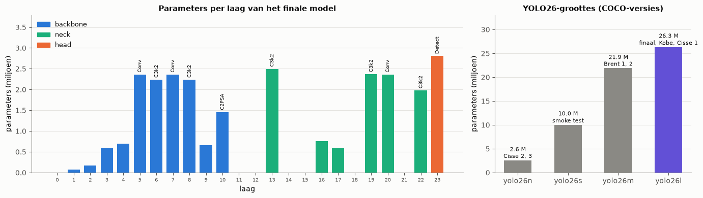
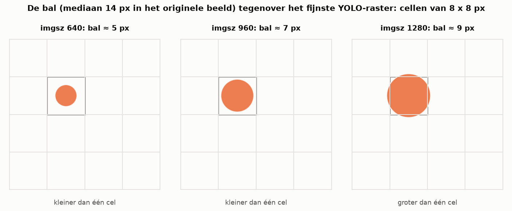
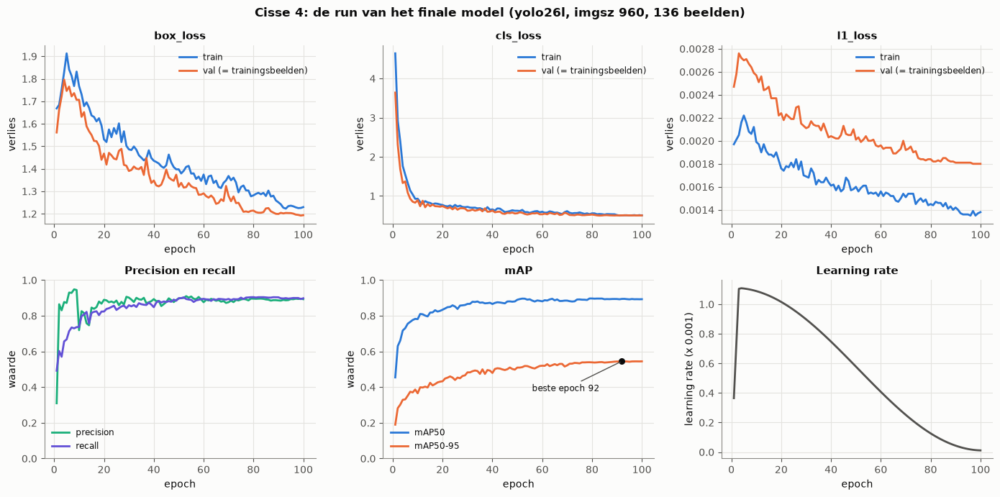
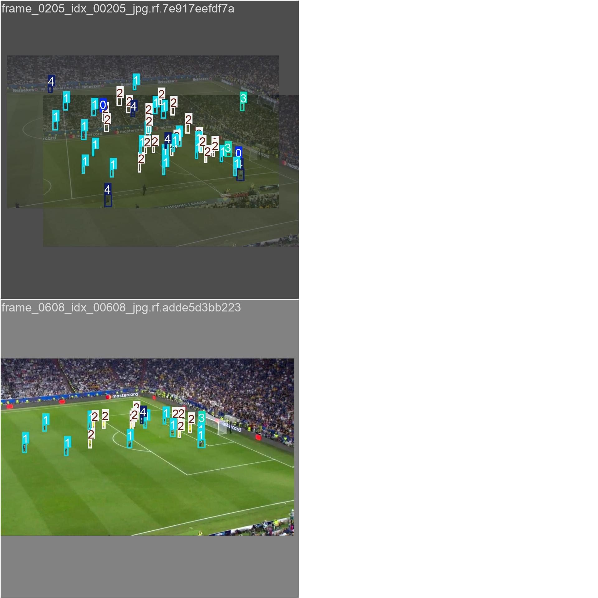

# 01. YOLO, YOLO26 en transfer learning

Hoe werkt het detectiemodel dat we gebruiken, en hoe hebben we het op onze clip afgestemd? De cijfers komen uit
`notebooks/01_model_training.ipynb` (secties 3 tot 5).

## 1. Objectdetectie met YOLO

Een objectdetector geeft voor een beeld een lijst boxen terug, elk met een klasse en een confidence (de zekerheid van het model, tussen 0 en 1).
**YOLO** ("You Only Look Once") doet dat in één doorgang door één convolutioneel netwerk. Er is geen aparte stap die eerst kandidaatregio's
voorstelt, en daarom is YOLO snel genoeg voor video.

Het netwerk bestaat uit drie delen:

| deel | wat het doet | in ons model (YOLO26l) |
|---|---|---|
| **backbone** | convolutieblokken die het beeld stap voor stap verkleinen (stride 2, 4, 8, 16, 32) en steeds abstractere kenmerken berekenen: eerst randen en kleuren, later vormen en objecten | lagen 0-10 (`Conv`, `C3k2`, `SPPF`, `C2PSA`), 12,8 M parameters |
| **neck** | combineert kenmerken van verschillende schalen (FPN/PAN: opschalen en samenvoegen), zodat ook de fijne lagen weten "wat" ze zien | lagen 11-22, 10,5 M parameters |
| **head** | voorspelt per rastercel op drie schalen een box en een score per klasse | `Detect` op stride 8, 16 en 32, 2,8 M parameters |

*Figuur: het aantal parameters per laag van ons model (notebook 01, sectie 4.2). De meeste parameters zitten in de diepe lagen van de backbone en de neck.*

**Stride en kleine objecten.** Op stride 8 is elke rastercel 8 x 8 pixels van het (verkleinde) invoerbeeld. Een object dat kleiner is dan
één cel, is voor het netwerk nauwelijks zichtbaar. Onze bal is in het originele beeld (1920 x 1080) ongeveer 14 px. YOLO verkleint het beeld
tot `imgsz` pixels aan de lange zijde, dus bij 640 is de bal nog 4,7 px, bij 960 nog 7 px en bij 1280 9,4 px. Daarom trainden we op 960 tot
1920 en draait de app inferentie op 1280.

*Figuur: de bal op drie beeldgroottes, getekend op het fijnste raster van YOLO (cellen van 8 x 8 px). Pas bij 1280 px is de bal groter dan één cel; dat is waarom de app op 1280 draait.*

**Verlies tijdens de training.** YOLO26 telt drie termen op:

* `box_loss`: hoe goed de voorspelde box overlapt met het label (op basis van IoU, de overlap gedeeld door de unie);
* `cls_loss`: binaire kruisentropie per klasse (is dit een bal, een speler van A, ...);
* `l1_loss`: de L1-afstand tussen de voorspelde en echte randen van de box.

**Evaluatie.** Een voorspelling telt als juist als ze de juiste klasse heeft en de IoU met een label minstens een drempel haalt. Over alle
confidence-drempels heen geeft dat een precision-recall-curve. De oppervlakte eronder is de AP. **mAP50** is de gemiddelde AP over de klassen bij
IoU 0,5. **mAP50-95** is het gemiddelde over IoU 0,50, 0,55, ..., 0,95 en beloont dus ook nauwkeurige boxen. Ultralytics bewaart als `best.pt`
de epoch met de hoogste mAP50-95.

## 2. Wat is nieuw aan YOLO26?

YOLO26 (ultralytics 8.4) is de opvolger van YOLOv8 en YOLO11. Voor ons project zijn dit de relevante verschillen, die we ook in onze bestanden terugzien:

* **Geen distribution focal loss meer.** De box wordt rechtstreeks voorspeld (`reg_max = 1` in ons model). In `results.csv` heet de derde verliesterm daarom `l1_loss` en niet meer `dfl_loss`.
* **Twee koppen.** Een "één-op-veel"-kop (meerdere voorspellingen per object, achteraf opgeruimd met NMS) en een "één-op-één"-kop die zonder
  NMS (non-maximum suppression) kan werken. Tijdens de training worden beide geleerd. Het effect van NMS bij inferentie staat in notebook 02.
* **Nieuwe optimizer MuSGD** voor lange trainingen. Bij korte trainingen zoals de onze kiest ultralytics toch AdamW (zie verder).

Er zijn vijf groottes. Wij gebruikten er vier (aantal parameters van de COCO-versies):

| model | parameters | gebruikt door |
|---|---|---|
| yolo26n | 2,6 M | Cisse 2 en 3 (imgsz 640) |
| yolo26s | 10,0 M | Kobe's smoke test (imgsz 640, CPU) |
| yolo26m | 21,9 M | Brent 1 en 2 (imgsz 1600) |
| yolo26l | 26,3 M | **het finale model** (imgsz 960), Kobe (1920), de bal-fine-tune (1280) |

## 3. Transfer learning

Een detector vanaf nul trainen vraagt honderdduizenden gelabelde beelden. Wij hebben er 136. Daarom starten we van gewichten die op **COCO**
getraind zijn (ongeveer 118 000 beelden, 80 klassen, waaronder `person` en `sports ball`). De backbone en de neck herkennen dan al randen, texturen,
menselijke vormen en ballen. Ultralytics bouwt de klassenuitgang van de head opnieuw op voor onze 5 klassen (`ball`, `player_A`, `player_B`,
`player_B_goal_keeper`, `referee`) en neemt alle andere gewichten over. Ons model heeft 26 184 054 parameters, 115 650 minder dan COCO-yolo26l:
precies het verschil tussen 80 en 5 klassenuitgangen. Daarna traint het **hele** netwerk verder (`freeze: null`). Dat heet **fine-tuning**.

Waarom werkt dat zo goed? In de finale run zakt het klassenverlies binnen 10 epochs van 4,6 naar onder 1. Het model hoeft "persoon" niet meer
te leren, alleen nog de indeling in teams en rollen, en die volgt vooral uit de shirtkleur.

*Figuur: verliezen en metrics per epoch van de finale run (notebook 01, sectie 3.4). Het klassenverlies zakt in de eerste epochs snel, omdat het model 'persoon' en 'bal' al van COCO kent. De validatie gebeurde op de trainingsbeelden zelf.*

Een aandachtspunt dat we zelf tegenkwamen: **een al getraind model nog eens fine-tunen vraagt een kleinere learning rate.** Onze bal-fine-tune
vertrok van het finale model met de standaardinstellingen. Zodra de warm-up de learning rate naar 0,0011 bracht, zakte de mAP50 op de validatie van
0,94 (epoch 1) naar ongeveer 0,75, en hij herstelde niet meer (notebook 01, sectie 3.5).

## 4. De hyperparameters van het finale model

Het finale model `psg_vs_inter_CV.pt` is getraind met het script `train_players.py` van Cisse (dezelfde instellingen staan uitvoerbaar in sectie 6 van notebook 01). De waarden hieronder komen uit de
`train_args` die in het modelbestand zelf zitten.

| parameter | waarde | uitleg |
|---|---|---|
| `model` | yolo26l.pt | grootste model dat we gebruikten, start vanaf COCO |
| `imgsz` | 960 | compromis tussen een zichtbare bal en GPU-geheugen |
| `epochs` / `patience` | 100 / 25 | maximaal 100 rondes; stop als de mAP50-95 25 epochs niet verbetert (alle 100 epochs gelopen, beste epoch 92) |
| `batch` / `nbs` | 2 / 64 | 2 beelden per stap; gradiënten van 32 stappen worden opgeteld tot één update met nominale batch 64 |
| `optimizer` / `lr0` | auto → AdamW / 0,001111 | ultralytics kiest AdamW als de training minder dan 10 000 iteraties telt (hier 300) en zet `lr0 = 0,002 x 5 / (4 + 5 klassen)` |
| `warmup_epochs` | 3 | de learning rate groeit eerst geleidelijk, zodat grote stappen de COCO-gewichten niet meteen beschadigen |
| `cos_lr` / `lrf` | true / 0,01 | daarna daalt de learning rate volgens een cosinus tot 1 % van lr0 |
| `weight_decay` | 0,0005 | regularisatie: kleine straf op grote gewichten |
| `mosaic` | 0,0 | uit. Mosaic plakt 4 beelden in één en maakt objecten kleiner, wat nadelig is voor onze kleine bal |
| `mixup` | 0,15 | 15 % van de beelden wordt half doorzichtig met een ander beeld gemengd (regularisatie tegen overfitting) |
| `copy_paste` | 0,1 | plakt objecten uit andere beelden, maar werkt alleen met segmentatiemaskers en heeft bij onze boxlabels dus geen effect |
| `scale` / `translate` | 0,2 / 0,1 | willekeurig zoomen (±20 %) en verschuiven (±10 %); kleiner dan de standaard 0,5 zodat de bal niet nog kleiner wordt |
| `fliplr` | 0,5 | horizontaal spiegelen; een voetbalveld is links-rechts symmetrisch |
| `hsv_h` / `hsv_s` / `hsv_v` | 0,015 / 0,7 / 0,4 | kleuraugmentatie; de tint (h) verandert maar weinig, want de shirtkleur bepaalt het team |
| `box` / `cls` | 7,5 / 0,5 | gewichten van box- en klassenverlies |
| `cls_pw` | 0 | geen klassengewicht. Alleen de bal-fine-tune gebruikte 0,5: gewicht = (1/frequentie)^0,5, zodat de zeldzame bal zwaarder telt |

*Figuur: de eerste trainingsbatch van de finale run, zoals ultralytics hem bewaarde. Elk beeld is willekeurig verschoven, geschaald, gespiegeld of van kleur veranderd, en soms gemengd met een tweede beeld (mixup).*

Resultaat: beste epoch 92 met mAP50 0,895 en mAP50-95 0,546, **gemeten op de trainingsbeelden zelf** (de `data.yaml` zet `val: train/images`).
Runs van Brent en Kobe met een echte tijdsblok-validatie haalden mAP50 0,78 en 0,67. Meer over de dataset en dit voorbehoud staat in
`02_dataset_en_labeling.md`; de evaluatie op ongeziene beelden staat in notebook 02.
