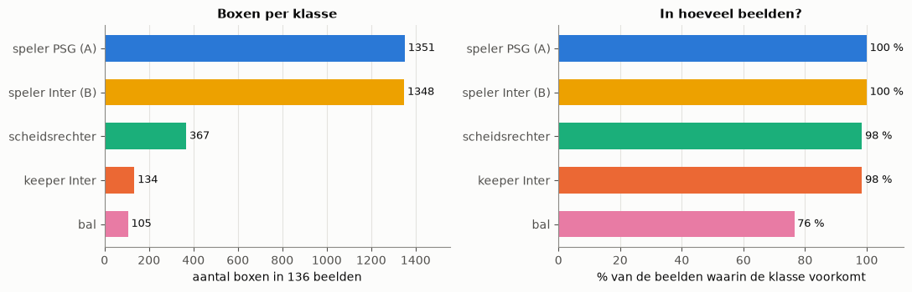
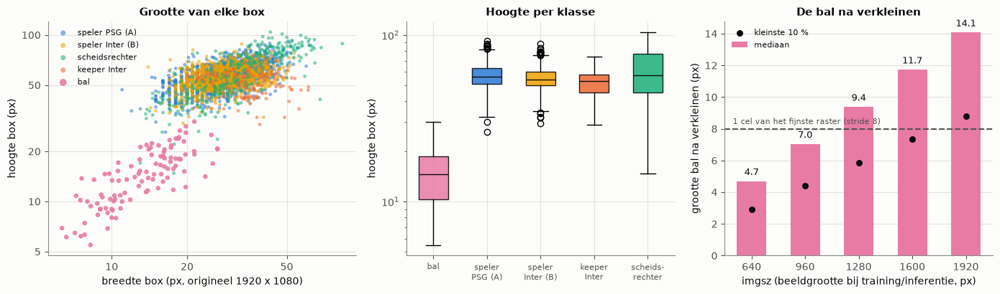
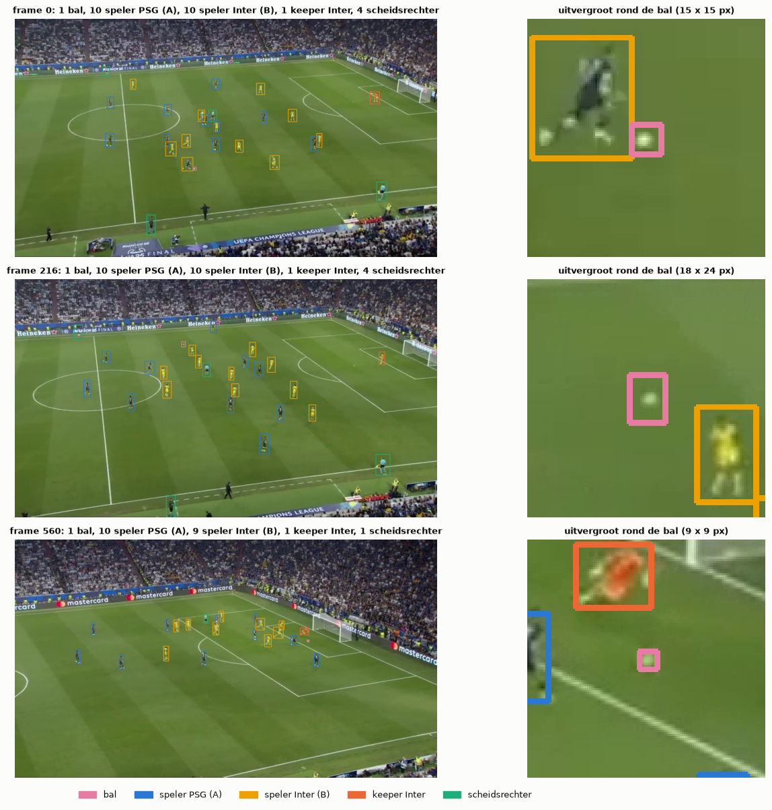
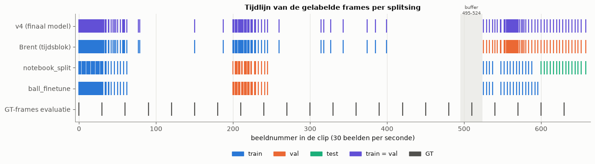

# 02. Dataset en labeling

Hoe is onze trainingsdata ontstaan, hoe hebben we gelabeld en gesplitst, en wat betekent dat voor de betrouwbaarheid van de cijfers?
Alle cijfers komen uit `notebooks/01_model_training.ipynb` (sectie 2), dat ze rechtstreeks uit de labelbestanden berekent.

## 1. Van clip tot gelabelde beelden

* **Bron:** één clip van PSG tegen Inter, 660 beelden, 30 beelden per seconde (22 s), 1920 x 1080, één breed camerastandpunt.
* **Beelden uitpakken:** het script `extract_frames.py` uit de projectrepository schrijft elk beeld als `frame_XXXX_idx_YYYYY.jpg`. Het getal na `idx` is het beeldnummer
  in de clip. Zo kunnen we elk label terug op de tijdlijn plaatsen en de splits per tijdsblok maken.
* **Labelen:** in **Roboflow** (project `object-detection-sjoav`), door het hele team. Export in YOLO-formaat: per beeld een `.txt` met per object
  `klasse x_midden y_midden breedte hoogte`, genormaliseerd op 0-1. Roboflow paste geen resize of augmentatie toe.
* **Groei:** de dataset groeide op 30 oktober in vier exports: 51 → 100 → 118 → **136 beelden (v4)**. Tussendoor kwamen er vooral beelden met een
  zichtbare bal bij. Het finale model is op v4 getraind: 136 beelden met 3 305 boxen.

## 2. De klassen

| id | klasse | boxen (v4) | mediane grootte (px, origineel) |
|---|---|---|---|
| 0 | `ball`: de wedstrijdbal | 105 (in 76 % van de beelden) | 14 x 15 |
| 1 | `player_A`: veldspeler PSG (donkerblauw) | 1 351 | 28 x 56 |
| 2 | `player_B`: veldspeler Inter (geel) | 1 348 | 27 x 54 |
| 3 | `player_B_goal_keeper`: keeper Inter (oranje) | 134 | 35 x 53 |
| 4 | `referee`: scheidsrechter en grensrechters (fluo) | 367 | 32 x 58 |

De dataset is sterk onevenwichtig: tegenover één bal staan er meer dan 25 spelers. Een COCO-model kent al "person", maar geen teams. Daarom
labelden we, anders dan het eerste protocol voorstelde, ook alle personen met hun rol.

*Figuur: aantal boxen per klasse in de 136 trainingsbeelden (notebook 01, sectie 2.3).*

*Figuur: grootte van de boxen per klasse, in het originele beeld en na verkleinen naar de beeldgrootte van het model (notebook 01, sectie 2.4). De bal is veel kleiner dan een speler.*

## 3. Het labelprotocol

De regels staan in `docs/labeling_protocol.md` (kopie in `data/results/training/labeling_protocol.md`). Ze zijn bedoeld om **label noise** te vermijden:
als vier mensen verschillend labelen, leert het model tegenstrijdige dingen.

* **Strakke box** rond de fysieke rand van de bal, **nooit de schaduw** (anders worden donkere vlekken een "bal").
* **Bewegingsonscherpte:** bij snelle ballen de hele zichtbare veeg in de box.
* **Bedekking:** een bal die voor 30 % of meer zichtbaar is, wordt gelabeld (box rond het zichtbare deel). Minder dan 30 %: niet labelen, want een label
  op pixels waar de bal niet te zien is, leert het model op achtergrond te reageren.
* **Rand van het beeld:** alleen labelen als meer dan de helft zichtbaar is.
* **Volledige beelden:** in een gelabeld beeld moeten **alle** objecten gelabeld zijn. Een beeld met alleen de bal gelabeld leert het model dat de spelers
  erop "achtergrond" zijn. Daarom werden in export v4 ook in de bal-beelden de spelers bijgelabeld, en hield Brent beelden met alleen een bal-label buiten de training.
* **Kruiscontrole:** elk teamlid controleert een batch labels van een ander.

*Figuur: gelabelde beelden met alle vijf klassen (notebook 01, sectie 2.7). De bal is een vlekje van enkele pixels dat sterk op een lijn of de penaltystip lijkt.*

Een gevolg dat we in de confusion matrix zien: het model meldt soms "spelers" op plaatsen zonder label (wisselspelers, mensen langs de lijn). Volgens het protocol
zijn die niet gelabeld, dus tellen ze als valse detecties.

## 4. Splitsen: waarom per tijdsblok?

Opeenvolgende beelden van een video lijken bijna perfect op elkaar. In onze clip is het gemiddelde verschil tussen twee buurbeelden maar een paar
grijswaarden, en ongeveer elk 6e beeld is een bijna-kopie van het vorige (129 beelden). Bij een **willekeurige** split komt beeld 101 in train en beeld 102 in
validatie. De validatie meet dan vooral of het model zich zijn trainingsbeelden herinnert. Dat is **data leakage**: informatie uit de evaluatiedata
lekt in de training, en de cijfers worden te optimistisch.

Daarom splitsen we **per tijdsblok**: aaneengesloten stukken van de clip gaan in hun geheel naar train, val of test, eventueel met een buffer ertussen.
In het project zijn vier splitsingen gebruikt (tijdlijn in notebook 01, sectie 2.5):

| splitsing | train | val | test | opmerking |
|---|---|---|---|---|
| Brent (smoke test) | frames 0-494 (86 beelden) | 525-659 (50) | – | buffer 495-524; eerlijk, maar val is één scène |
| `notebook_split` | 0-62 en 525-588 (51) | 200-245 (23) | 600-658 (15) | gebruikt door Kobe's run en als testset in notebook 02 |
| `ball_finetune` | < 200 en 246-599 (59) | 200-245 (26) | – | voor de bal-fine-tune; frames ≥ 600 bewust weggelaten |
| **finaal model (v4)** | alle 136 | **dezelfde 136** | – | `data.yaml`: `val: train/images` |

*Figuur: welke van de 660 frames gelabeld zijn en in welke split ze zitten (notebook 01, sectie 2.5). De gelabelde beelden liggen in drie dichte blokken; het middenstuk van de clip is nauwelijks gelabeld.*

## 5. Wat ging er mis, en wat betekent dat?

* **Het finale model heeft geen eerlijke validatie.** Zijn mAP50 van 0,895 is gemeten op de trainingsbeelden. Runs met een tijdsblok-validatie haalden
  0,67 (Kobe, 23 beelden) tot 0,78 (Brent, 50 beelden).
* **Overlap tussen train en test.** Omdat het finale model op alle 136 beelden trainde, zitten de testframes van `notebook_split` (600-658), de val-frames van
  `ball_finetune` (200-245) en 7 van de 22 handmatige GT-frames (0, 30, 150, 210, 540, 570, 600) in zijn trainingsdata. Wie het model daarop test,
  krijgt te mooie cijfers. Notebook 02 en de systeemevaluatie vermelden dat telkens.
* **Ongelijk gespreide labels.** De gelabelde beelden liggen in drie dichte blokken (begin, rond 200-245, einde). Het middenstuk (63-199 en 246-524)
  heeft maar een handvol beelden. Voor een eerlijke test zouden we daar nieuwe frames labelen: `export_unseen_frames.py` (in de projectrepository onder `kobe/match_analyse/gpu/`) zet ze klaar.
* **Kleine evaluatiesets.** De test van `notebook_split` telt 5 ballen. Eén bal meer of minder verschuift de bal-recall met 20 procentpunten.

**Wat we de volgende keer anders zouden doen:** eerst een vaste testset per tijdsblok apart zetten en nooit gebruiken voor training of modelkeuze,
gelabelde beelden gelijkmatiger over de clip spreiden (elk n-de beeld in plaats van blokken van opeenvolgende beelden) en de `val:`-regel in
`data.yaml` controleren vóór elke training.
