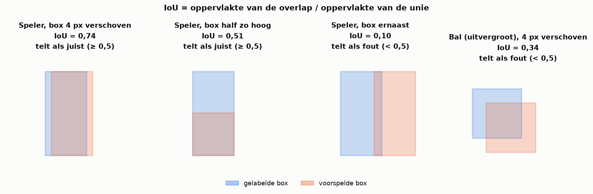
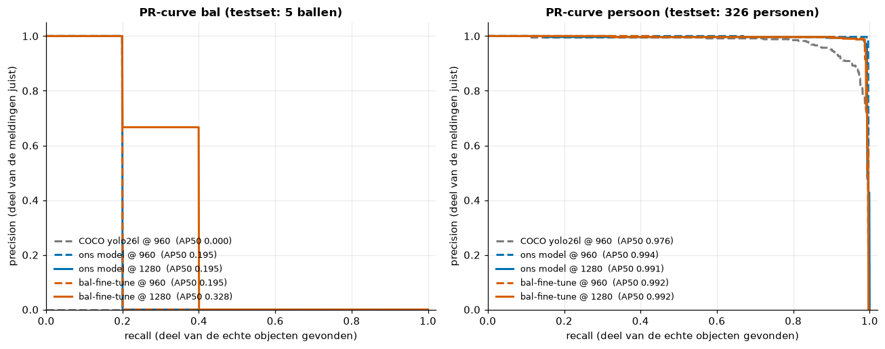
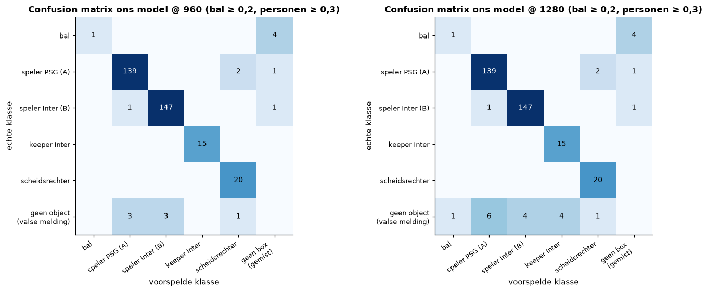
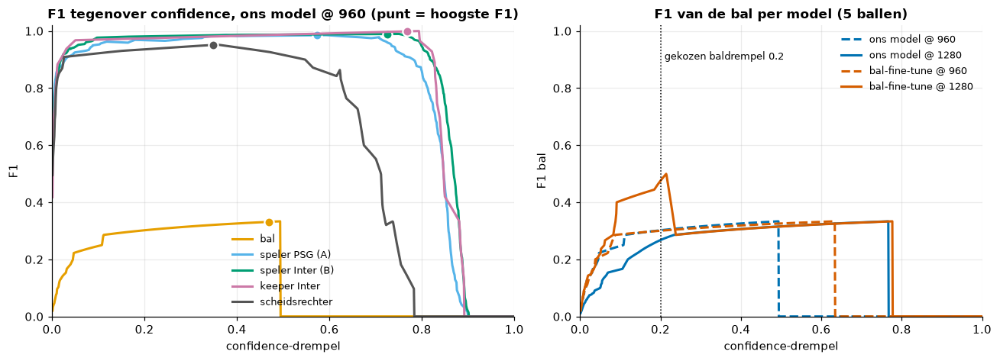
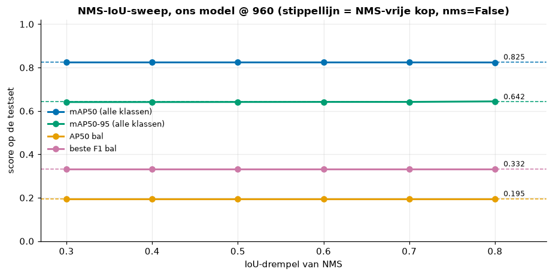

# 03. Evaluatie van een objectdetector: de maten

Dit bestand legt de maten uit waarmee we ons detectiemodel beoordeelden. De berekeningen en grafieken staan in
`notebooks/02_fine_tuning.ipynb`; de ruwe resultaten in `data/results/gpu_run/`.

## IoU: wanneer is een box juist?

**IoU** (intersection over union) meet hoe goed twee boxen overlappen: de oppervlakte van de doorsnede gedeeld door de
oppervlakte van de unie. 1 = perfect dezelfde box, 0 = geen overlap. Een voorspelde box telt als **juist** (true
positive, TP) als hij een gelabelde box van dezelfde klasse overlapt met een IoU boven een drempel, meestal 0,5. Elk
gelabeld object mag maar één keer gevonden worden. Een box zonder passend label is een **valse melding** (false
positive, FP); een label zonder passende box is een **misser** (false negative, FN).

Bij kleine objecten is IoU streng: bij onze bal van ±15 pixels (in een frame van 1920×1080) betekent een paar pixels
verschuiving al een veel lagere IoU.

*Figuur: dezelfde verschuiving van 4 px geeft bij een spelerbox (27 x 55 px) een IoU van 0,74, maar bij een balbox (14 x 14 px) maar 0,34: de balbox telt dan als fout.*

## Precision, recall en F1

- **Precision** = TP / (TP + FP): welk deel van de meldingen juist is.
- **Recall** = TP / (TP + FN): welk deel van de echte objecten gevonden wordt.
- **F1** = 2 · P · R / (P + R): het harmonisch gemiddelde. F1 is alleen hoog als **beide** hoog zijn.

Precision en recall hangen af van de **confidence-drempel**. Elke box krijgt van YOLO een confidence (0–1). Een hoge
drempel houdt alleen zekere boxen over (hoge precision, lage recall); een lage drempel houdt veel boxen over (hoge
recall, meer valse meldingen).

## PR-curve, AP, mAP50 en mAP50-95

Schuif je de drempel van 1 naar 0, dan krijg je bij elke drempel een punt (recall, precision). Samen vormen die de
**precision-recall-curve**. Een perfect model zit in de rechterbovenhoek.

- **AP** (average precision) = de oppervlakte onder de PR-curve van één klasse, bij een vaste IoU-drempel.
- **AP50** = AP bij IoU 0,5. **mAP50** = het gemiddelde van AP50 over alle klassen ("mean").
- **mAP50-95** = het gemiddelde van de AP over de IoU-drempels 0,50, 0,55, ..., 0,95. Deze maat beloont boxen die héél
  precies op het object liggen, niet alleen ongeveer.

**Bij ons** (testset van 15 beelden, 5 ballen en 326 personen; persoon = alle spelers, keeper en scheidsrechter samen):

| Model | bal AP50 | persoon AP50 | persoon mAP50-95 |
|---|---|---|---|
| COCO yolo26l (basismodel) | 0,000 | 0,976 | 0,669 |
| ons model @ 960 | 0,195 | 0,994 | 0,815 |

COCO vindt geen enkele bal. Ons model vindt er één van de vijf (recall 0,2). Met maar 5 ballen springt de PR-curve van
de bal in stappen van 0,2; elk verschil in bal-AP is dus één bal meer of minder.

*Figuur: precision-recall-curves van het COCO-basismodel, ons model en de bal-fine-tune op de testset (notebook 02, sectie 2). Bij personen liggen alle curves tegen de rechterbovenhoek; bij de bal springt de curve in stappen van 0,2 omdat er maar 5 ballen zijn.*

## Confusion matrix

Een **confusion matrix** telt per echte klasse welke klasse het model voorspelde. Bij een detector komen er een rij en
een kolom bij: "geen object" (een valse melding) en "geen box" (een gemist object). De diagonaal is wat goed gaat; alles
ernaast toont welke klassen verward worden. Bij ons (eigen berekening op de 15 testbeelden, bal ≥ 0,2, personen ≥ 0,3):
321 van de 324 gekoppelde personen krijgen de juiste rol, 2 personen worden gemist, en 4 van de 5 ballen worden gemist.

*Figuur: onze eigen confusion matrix op de 15 testbeelden (notebook 02). Bijna alles staat op de diagonaal; de bal is de zwakke plek.*

## De confidence-drempel kiezen

Een veelgebruikte keuze is de drempel met de **hoogste F1**. Voor onze spelers is de F1-curve een breed plateau (F1 >
0,95 tussen ongeveer 0,1 en 0,7), dus de exacte keuze maakt weinig uit. Voor de bal geeft de F1-curve 0,47, maar die
waarde rust op 5 ballen. We kozen de baldrempel daarom op de hele pijplijn tegen de ground truth: **0,2** (zie
`04_fine_tuning_en_inferentie_instellingen.md`). Een lagere drempel voor de bal is verdedigbaar omdat de bal klein en
onzeker is (de meeste baldetecties hebben een confidence onder 0,3) en omdat een tracker losse valse ballen opvangt.

*Figuur: F1 per klasse als functie van de confidence-drempel (notebook 02, sectie 3). Voor spelers is de curve een breed plateau, dus de exacte drempel maakt daar weinig uit.*

## NMS (non-maximum suppression)

Een detector geeft rond één object vaak meerdere, licht verschoven boxen. **NMS** sorteert de boxen op confidence,
houdt de beste en verwijdert elke andere box van dezelfde klasse die er met een IoU boven een drempel (bij ons 0,7) mee
overlapt. Een te lage drempel verwijdert ook echte, overlappende spelers; een te hoge laat dubbele boxen staan.

YOLO26 heeft daarnaast een **NMS-vrije kop** (one-to-one), getraind om per object maar één box te geven. In ultralytics
8.4.182 gebruikt ons model standaard de klassieke kop met NMS; met `nms=False` schakelt het over.

**Bij ons:** mAP50 blijft 0,823–0,825 voor elke IoU-drempel van 0,3 tot 0,8 én voor de NMS-vrije kop. De verschillen
zitten vooral in zwakke boxen, die de AP nauwelijks beïnvloeden. In de pijplijn gaf de NMS-vrije kop een slechtere
rolherkenning en balbezit, dus de standaard bleef NMS met IoU 0,7.

*Figuur: mAP50 voor NMS-IoU 0,3 tot 0,8 en voor de NMS-vrije kop (notebook 02, sectie 4): een vlakke lijn.*

## Data leakage

**Data leakage** betekent dat informatie uit de testset in de training terechtkwam. De test meet dan niet meer hoe goed
het model werkt op onbekende beelden, maar deels hoe goed het zich zijn trainingsbeelden herinnert. Bij video is dat
extra verraderlijk: twee frames die 1/30 seconde uit elkaar liggen zijn bijna identiek, dus ook een "buurframe" in de
training is een lek.

**Bij ons:** alle 15 testbeelden (frames 600–658) zaten in de 136 trainingsbeelden van ons model. De detectiecijfers
hierboven zijn daarom te optimistisch. De vergelijking met COCO blijft als illustratie zinvol (COCO zag deze beelden
nooit en vindt toch geen bal). De eerlijkste meting die we hebben, is de pijplijn op de hele clip tegen de ground
truth (elk 30e frame, voor een deel in het weinig gelabelde middenstuk van de clip; 7 van de 22 frames zijn wel
trainingsframes). Een echt eerlijke testset vraagt nieuwe, gelabelde frames uit het middenstuk (ongeveer 63–199 en
246–524).
