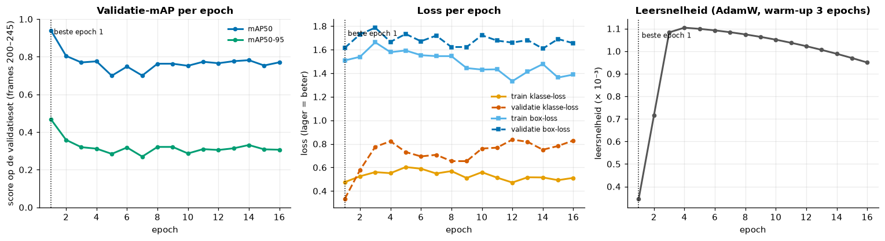
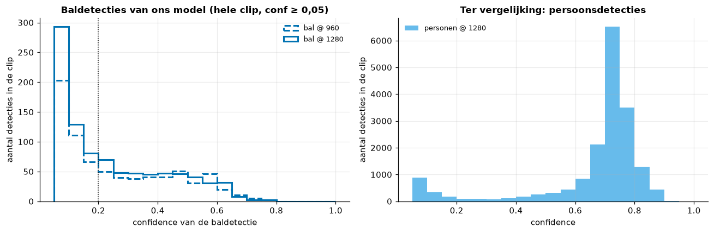
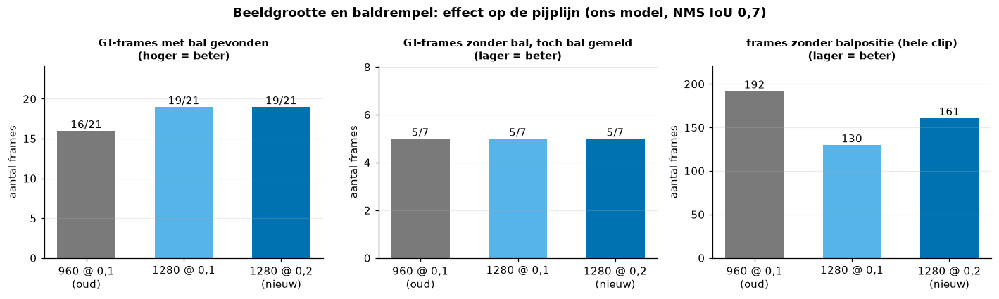
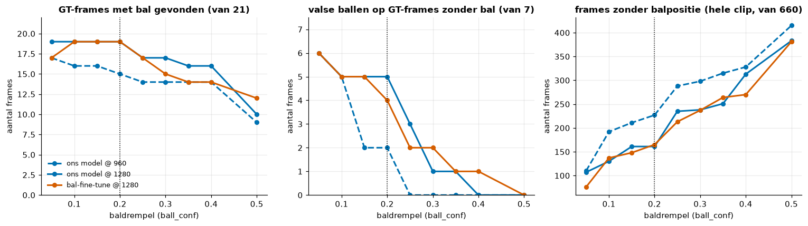

# 04. Fine-tunen en de instellingen bij inferentie

Dit bestand legt uit wat fine-tunen is, waarom onze extra fine-tune voor de bal mislukte, en hoe we de instellingen
kozen waarmee het model in de pijplijn draait. Details, grafieken en alle getallen: `notebooks/02_fine_tuning.ipynb`.
Het trainen van het model zelf staat in `notebooks/01_model_training.ipynb`.

## Wat is fine-tunen?

Een netwerk vanaf nul trainen vraagt heel veel gelabelde beelden. Bij **fine-tunen** (een vorm van transfer learning)
vertrek je van gewichten die al op een grote dataset getraind zijn, hier YOLO26l op COCO (80 klassen, waaronder
`person` en `sports ball`). De eerste lagen herkennen al randen, texturen en vormen; je traint verder op je eigen data
met je eigen klassen. Zo volstonden voor ons model 136 gelabelde frames met 5 klassen (`ball`, `player_A`, `player_B`,
`player_B_goal_keeper`, `referee`).

Het verschil is groot: het COCO-model vindt op onze testset geen enkele bal (AP50 0,000), ons fine-tuned model wel
(0,195), en het omkadert personen veel nauwkeuriger (mAP50-95 0,815 tegenover 0,669). Het COCO-model kan bovendien
geen teams onderscheiden.

## Klassengewichten

In onze data staat ±1 bal per beeld tegenover ±20 personen. Bij gewone training draagt de bal dan weinig bij aan de
loss. **Klassengewichten** geven zeldzame klassen meer gewicht in de klasse-loss. Ultralytics 8.4.182 heeft daarvoor
`cls_pw`: gewicht = (1 / frequentie)^`cls_pw`, daarna genormaliseerd. Met `cls_pw 0.5` kregen de klassen in onze
fine-tune de gewichten bal 1,72, PSG 0,47, Inter 0,47, keeper 1,48, scheidsrechter 0,86 (uit het trainingslog).

## Learning rate (leersnelheid)

De **learning rate** bepaalt hoe groot elke aanpassing van de gewichten is. Te klein: het model leert traag. Te groot:
het model springt over goede oplossingen heen of overschrijft wat het al kon ("catastrophic forgetting"). Bij het
verder trainen van een model dat al goed is, kies je een **kleinere** leersnelheid dan bij een eerste training, en
bevries je vaak de eerste lagen (`freeze`), zodat alleen de laatste lagen bijleren. Een **warm-up** laat de leersnelheid
de eerste epochs langzaam oplopen; een **cosine-schema** laat ze daarna geleidelijk dalen.

## Early stopping

Na elke epoch meet je de prestatie op een **validatieset** (beelden die niet in de training zitten). Verbetert die
`patience` epochs lang niet meer, dan stop je en hou je de beste epoch. Zo voorkom je overfitting (het model leert de
trainingsbeelden vanbuiten in plaats van algemene kenmerken). Bij video moet de validatieset in de **tijd** gescheiden
zijn van de training, anders bevat ze bijna identieke buurframes.

## Onze bal-fine-tune, en waarom hij mislukte

**Opzet:** start van ons model, imgsz 1280, `cls_pw 0.5`, max. 60 epochs met patience 15, de 100 frames van een oudere export van de dataset per
tijdsblok gesplitst (59 train: frames < 200 en 246–599; 26 validatie: frames 200–245; de testframes ≥ 600 weggelaten).
GPU van een teamgenoot, 23,6 minuten.

**Resultaat:** de beste validatiescore kwam na **epoch 1** (mAP50 0,941). Daarna zakte mAP50 naar 0,70–0,80 en steeg de
validatie-klasse-loss van 0,33 naar 0,58–0,84; na 16 epochs stopte early stopping de training.

*Figuur: verliezen, mAP en learning rate per epoch van de bal-fine-tune (notebook 02, sectie 6). De beste score valt in epoch 1; zodra de learning rate oploopt, gaat de validatiescore achteruit.*

**Waarom:**

1. **Te hoge leersnelheid voor fine-tunen.** Het script zette `lr0=0.01`, maar met `optimizer=auto` negeert ultralytics
   die waarde en koos het AdamW met leersnelheid 0,001111. Tijdens de warm-up liep die op van 0,00035 (epoch 1) naar
   0,0011 (epoch 3–4), en precies dan ging het model achteruit: het al getrainde model werd overschreven in plaats van
   bijgestuurd.
2. **Geen bevroren lagen**: het hele netwerk werd aangepast op 59 beelden.
3. **Weinig nieuwe informatie**: 59 trainingsbeelden met ±1 bal elk, allemaal beelden die het startmodel al kende.
4. **Ook de validatie lekte**: de validatiebeelden (200–245) zaten in de training van het startmodel. De 0,941 na
   epoch 1 is dus vooral herinnering.

Een volgende poging zou de optimizer en een lagere leersnelheid expliciet vastzetten en de eerste lagen bevriezen; dat
is niet meer getest. In de pijplijn deed de fine-tune het niet beter dan ons model op dezelfde beeldgrootte (op 1280:
beide 19 van de 21 ballen gevonden, beide 5 van 7 valse ballen), dus hij wordt niet gebruikt
(`models/experimenten/best_ball_ft.pt` staat er alleen ter vergelijking).

## Beeldgrootte bij inferentie

YOLO schaalt elk frame naar `imgsz` pixels (langste zijde) voor het het netwerk in gaat. Ons model is getraind op 960:
het frame van 1920 pixels breed wordt dan gehalveerd, en een bal van ±15 pixels wordt ±7 pixels. Na de eerste lagen
(die het beeld telkens halveren) blijft daar weinig van over. Inferentie op een **grotere** beeldgrootte dan de
training mag, omdat het netwerk convolutioneel is; het ziet objecten dan wel groter dan het gewend is, wat bij
personen iets meer valse meldingen geeft. De prijs is rekentijd: op de CPU is 1280 ±2× trager dan 960.

*Figuur: baldetecties van ons model op 960 en 1280 px (notebook 02, sectie 5). Op 1280 vindt het model in meer frames een bal; de meeste baldetecties hebben een confidence onder 0,3.*

**Bij ons was dit de grootste winst van de hele afstelling**, zonder extra training:

| Instelling (ons model) | GT-frames met bal gevonden | valse ballen | frames zonder bal (clip) |
|---|---|---|---|
| imgsz 960, baldrempel 0,1 (oude standaard) | 16 / 21 | 5 / 7 | 192 |
| imgsz 1280, baldrempel 0,1 | 19 / 21 | 5 / 7 | 130 |
| **imgsz 1280, baldrempel 0,2 (gekozen)** | **19 / 21** | **5 / 7** | **161** |

Spelers, rollen en balbezitnauwkeurigheid bleven gelijk.

*Figuur: de pijplijn op de hele clip met 960 en met 1280 px (notebook 02, sectie 5): meer gevonden ballen en minder frames zonder bal, bij evenveel valse ballen.*

## Hoe we de instellingen kozen

1. **Detectieniveau** (GPU-run, `val()` op de testset): PR-curves en mAP per model, beste F1-drempel per klasse,
   NMS-IoU-sweep. Nuttig om te vergelijken, maar met leakage en maar 5 ballen niet beslissend.
2. **Pijplijnniveau** (hele clip, gemeten tegen de ground truth van 28 frames): bal gevonden, valse ballen, frames zonder
   bal, rollen, balbezit. Omdat de YOLO-detecties per instelling in een cache staan, draait elke variant in een paar
   seconden. Hierop werd beslist.
3. **Visuele controle** van verdachte stukken (volgens de projectnotities: stilliggende valse ballen in frames 366–376
   met confidence 0,11–0,14 op 1280, die baldrempel 0,2 wegfiltert).

*Figuur: gevonden ballen, valse ballen en frames zonder bal als functie van de baldrempel, voor 960 en 1280 px en voor de fine-tune (notebook 02, sectie 7). 0,2 is de hoogste drempel waarbij nog 19 van de 21 ballen gevonden worden.*

**Gekozen standaard** (`streamlit/core/pipeline.py`): het oorspronkelijke model `models/psg_vs_inter_CV.pt`,
`imgsz 1280`, baldrempel 0,2 (een nieuwe baltrack start pas vanaf 0,25), persoonstrack vanaf 0,3, NMS met IoU 0,7.

**Kanttekening:** de instellingen werden gekozen op dezelfde 28 ground-truth-frames waarop we ze rapporteren; er was geen
aparte set om de keuze onafhankelijk te bevestigen.
