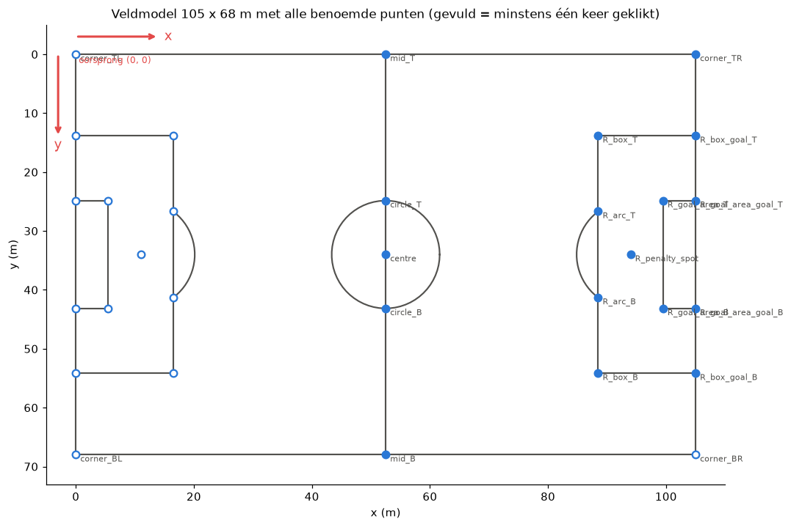
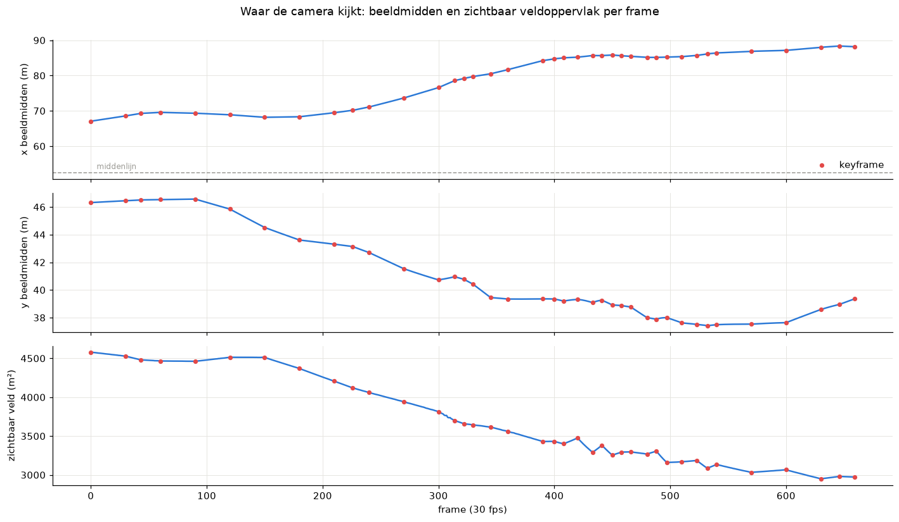
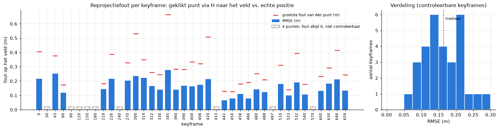
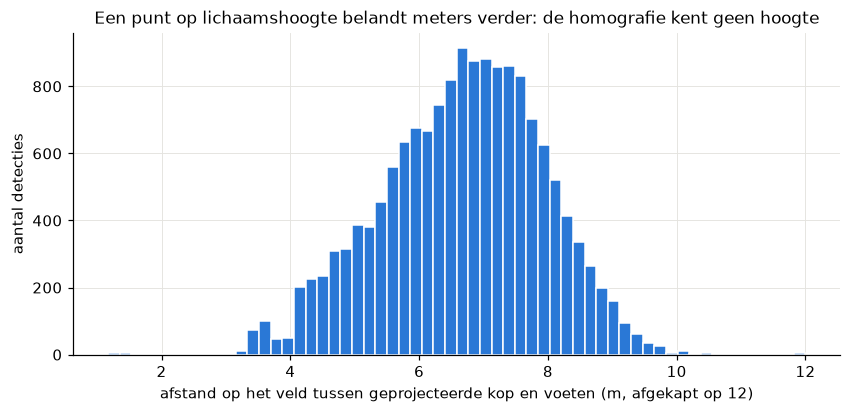
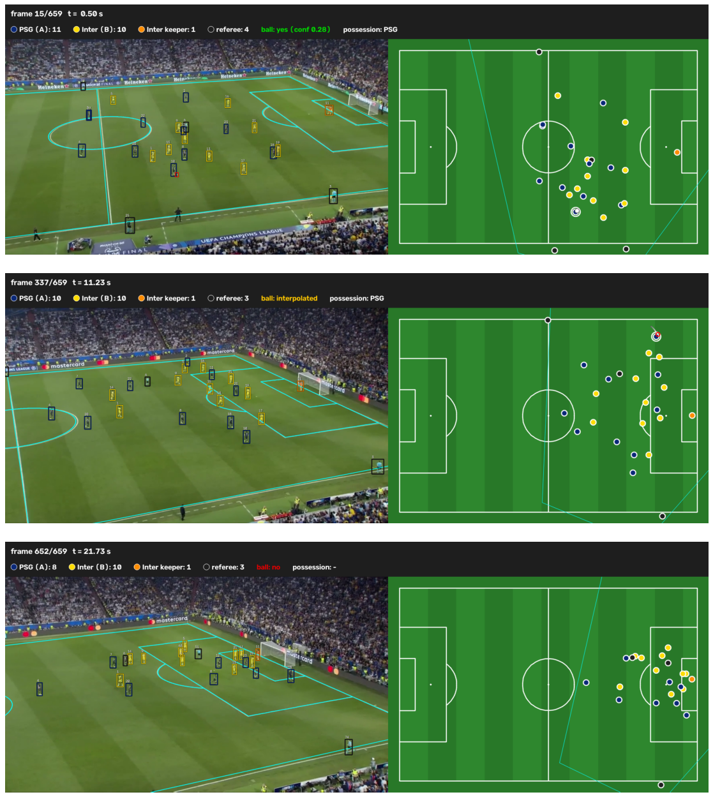
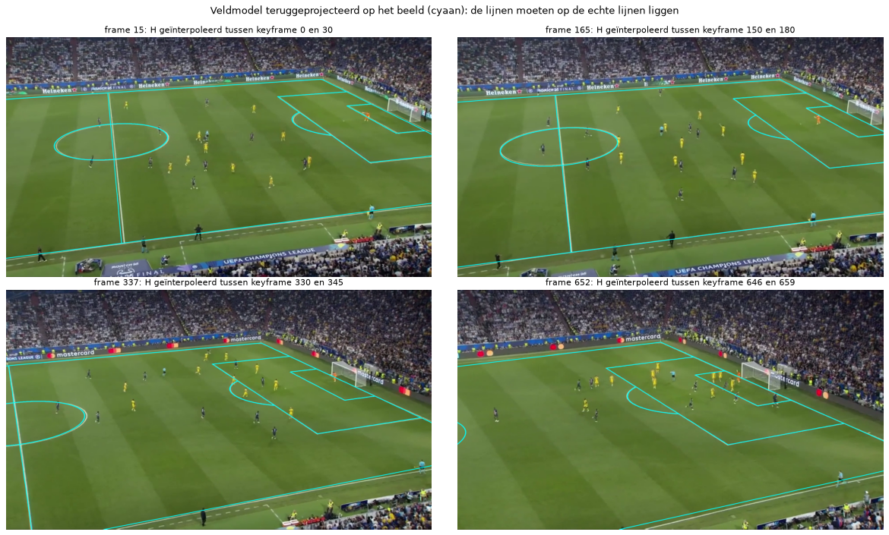
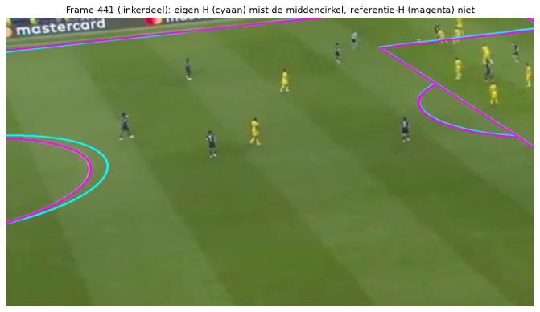

# 05. Homografie: van pixels naar meters op het veld

Uitgewerkt en uitgevoerd in [`notebooks/03_homografie_en_minimap.ipynb`](../notebooks/03_homografie_en_minimap.ipynb).
De figuren hieronder staan in `data/results/homografie/`; de code staat in `streamlit/core/homography.py` en
`streamlit/core/pitch.py`.

## 1. Het probleem

Het detectiemodel geeft per speler een box in pixels. Een minimap heeft posities in meters op een veld van 105 x 68 m
nodig. We kiezen het assenstelsel zoals het tv-beeld: oorsprong in de hoek van de verre zijlijn en de linkerdoellijn,
x langs de zijlijn (0-105 m), y over de breedte (0 = verre zijlijn boven in beeld, 68 = dichtbije zijlijn onder in
beeld, waar de camera staat).

*Figuur: het veldmodel van 105 x 68 m met het assenstelsel en de benoemde punten die geklikt kunnen worden (notebook 03, sectie 1).*

De camera in onze clip (660 frames, 22 s) pant en zoomt: het beeldmidden schuift van x ≈ 67 m naar x ≈ 88 m en het
zichtbare veld krimpt van 64 % naar 41 % van het veld. Eén vaste omrekening volstaat dus niet: elk frame krijgt zijn
eigen matrix.

## 2. Homogene coördinaten en de matrix

Een beeldpunt $(u, v)$ schrijven we in **homogene coördinaten** als $(u, v, 1)$. Een **homografie** is een 3x3-matrix
$H$ die een vlak op een ander vlak afbeeldt:

$$\begin{pmatrix} x' \\ y' \\ w \end{pmatrix} = \begin{pmatrix} h_{11} & h_{12} & h_{13} \\ h_{21} & h_{22} & h_{23} \\
h_{31} & h_{32} & h_{33} \end{pmatrix} \begin{pmatrix} u \\ v \\ 1 \end{pmatrix}, \qquad (X, Y) = \left(\frac{x'}{w}, \frac{y'}{w}\right)$$

De deling door $w$ maakt het een **projectieve** afbeelding: ze kan perspectief beschrijven (evenwijdige veldlijnen die
in het beeld naar een verdwijnpunt lopen). Is de derde rij $(0, 0, 1)$, dan is $w = 1$ en houd je een affiene
transformatie over (rotatie, schaal, afschuiving, verschuiving), die geen perspectief kan weergeven.

**Vrijheidsgraden.** $H$ en $kH$ geven voor elke $k \neq 0$ hetzelfde resultaat, want $k$ valt weg bij de deling. Van de
9 getallen zijn er dus maar **8 vrij**. Elk puntpaar (beeldpunt, veldpunt) levert 2 vergelijkingen, dus zijn er
**minstens 4 puntparen** nodig, waarvan geen 3 op één lijn liggen (anders is het stelsel ontaard).

**De inverse** $H^{-1}$ gaat de andere kant op: van meters naar pixels. Daarmee tekenen we het veldmodel over het beeld
als controle.

## 3. H schatten: DLT

Uit $X = (h_{11}u + h_{12}v + h_{13}) / (h_{31}u + h_{32}v + h_{33})$ volgt na vermenigvuldigen een vergelijking die
**lineair** is in de 9 onbekenden:

$$h_{11}u + h_{12}v + h_{13} - X(h_{31}u + h_{32}v + h_{33}) = 0$$

en hetzelfde voor $Y$. De **Direct Linear Transform** (DLT) stapelt deze 2 rijen per puntpaar in een matrix $A$
($2n \times 9$) en zoekt $h$ met $\|h\| = 1$ die $\|Ah\|$ minimaliseert. Dat is de rechtssinguliere vector bij de kleinste
singuliere waarde van $A$ (SVD). Met precies 4 punten is $Ah = 0$ exact oplosbaar; met meer punten is het een
kleinste-kwadratenoplossing. Vooraf normaliseer je beide puntenwolken (zwaartepunt naar de oorsprong, gemiddelde afstand
$\sqrt{2}$), anders is het stelsel numeriek slecht geconditioneerd.

`cv2.findHomography` doet een DLT en verfijnt het resultaat daarna door de echte terugprojectiefout te minimaliseren.
In het notebook (sectie 2) schreven we zelf een DLT in een tiental regels numpy: voor keyframe 0 (10 punten) geeft die
bijna dezelfde matrix als OpenCV, met een RMSE van 0,223 m tegenover 0,215 m voor OpenCV.

## 4. RANSAC

Kleinste kwadraten laten elk punt even zwaar meetellen, dus één misklik trekt de hele oplossing scheef. **RANSAC**
(*random sample consensus*) fit herhaaldelijk een $H$ op 4 willekeurige puntparen, telt hoeveel andere paren binnen een
drempel passen (*inliers*), houdt de beste set en fit daarop opnieuw. Uitschieters doen dan niet mee.

Wij gebruiken: 4 punten -> exacte oplossing (RANSAC heeft niets om tegen te controleren); 5 of meer punten -> RANSAC met
een drempel van **1,0 m op het veld**. In de echte klikken verwierp RANSAC geen enkel punt (0 van 269). In een proef
met één opzettelijke misklik van 29 px (keyframe 270) steeg de RMSE met gewone kleinste kwadraten van 0,20 naar 0,30 m,
met RANSAC bleef ze 0,21 m.

## 5. Reprojectiefout

De **reprojectiefout** zegt hoe goed $H$ bij de klikken past: zet elk geklikt pixel met $H$ om naar meters en meet de
afstand tot de echte positie van dat punt in het veldmodel. Per keyframe rapporteren we de RMSE
$\sqrt{\tfrac{1}{n}\sum_i \|H(p_i) - P_i\|^2}$ in **meters**: een pixel ver weg weegt op het veld tot 3 keer zwaarder
dan een pixel vooraan (0,06 tot 0,18 m per pixel op het voetpunt van spelers), en meters zijn wat de minimap gebruikt.

Twee valkuilen:
- Met precies 4 punten is de fout **altijd 0**: die keyframes zijn niet controleerbaar. Bij ons geldt dat voor 9 van de
  39 keyframes.
- De fout wordt gemeten op dezelfde punten als waarop gefit is. Ze zegt niets over plekken **ver van de klikken**. Daarom
  deden we in het notebook ook weglaat-tests (een punt of een hele keyframe weglaten en voorspellen).

## 6. Waarom het alleen in het veldvlak klopt

Een homografie beeldt **één vlak** af op **één ander vlak**. Een camera bekijkt een 3D-wereld; voor de punten van het
grasvlak is de afbeelding van veld naar beeld exact een homografie (een pinhole-camera zonder lensvervorming
aangenomen). Een punt **boven** het gras, zoals een hoofd of een bal in de lucht, ligt niet in dat vlak. De matrix zet
het op de plek waar de kijklijn van de camera door dat punt het gras raakt, en dat is altijd **verder van de camera**.

Daarom gebruiken we voor spelers het **voetpunt** (midden van de onderkant van de box). Hoe groot het effect is, maten we
door ook de bovenkant van elke spelerbox om te rekenen: die belandt mediaan **6,8 m** van het voetpunt (p5-p95:
4,5-8,6 m). Een bal in de lucht wordt op dezelfde manier meters te ver gezet. Ook een rollende bal heeft een kleine vaste
fout: we projecteren het midden van de balbox, terwijl het contactpunt de onderkant is; dat scheelt mediaan 0,91 m.

## 7. Hoe wij het toepasten

1. **Keyframes klikken** (`streamlit/click_keypoints.py`): op 39 keyframes (elk 30e frame plus 13 extra) zijn in totaal
   305 punten van het veldmodel aangeklikt, 4 tot 12 per frame (mediaan 9). Het veldmodel kent 31 benoemde punten; de
   camera ziet nooit de linkerhelft, dus maar 17 punten zijn gebruikt, vooral rond het rechterstrafschopgebied.
2. **Fit per keyframe** met `cv2.findHomography` (exact bij 4 punten, RANSAC vanaf 5).
3. **Interpolatie tussen keyframes** (`Homographies._for_frame`): een rooster van 30 veldpunten wordt in de twee
   omliggende keyframes geprojecteerd, de pixelposities worden lineair in de tijd geïnterpoleerd, en op die 30 punten
   wordt een nieuwe $H$ gefit. Zo heeft elk van de 660 frames een geldige homografie.
4. **Gebruik** in de pipeline: voetpunten van spelers en het midden van de balbox gaan met de $H$ van hun frame naar
   meters; detecties meer dan 3 m buiten de lijnen vallen weg.

*Figuur: een videoframe met de detecties, naast de minimap waarop dezelfde spelers en de bal in meters staan (notebook 03, sectie 7).*

## 8. Onze getallen

| Meting | Resultaat |
|---|---|
| Klikprecisie | mediaan 2,1 px (0,12 m) per klik, geen enkele klik > 10 px |
| Reprojectiefout per keyframe | RMSE 0,07-0,28 m, mediaan 0,16 m (30 controleerbare keyframes) |
| Eén punt weglaten | binnen het klikgebied mediaan 0,19 m; erbuiten 0,40 m (p90 1,15 m) |
| Eén keyframe weglaten (drift, bovengrens) | mediaan 0,33 m, max 0,83 m (frame 300, snelle pan) |
| Ver van de klikken (middencirkel, frames 420 en 441) | 1,2-1,5 m (mediaan) naast de echte cirkel |
| Spelers tegen voetlabels (6 frames, 140 spelers) | gemiddeld 1,09 m; na aftrek van een vaste verschuiving van 1 m: 0,48 m |

De witte-lijncontrole van `check_homography.py` markeerde 10 keyframes als zwak (150, 420, 441, 458, 466, 480, 488,
510, 523, 540). Die zijn niet herklikt, en dat zou ook niet helpen: hun reprojectiefout is laag (0,07-0,21 m). De lage
score komt van extrapolatie. Vanaf frame 420 liggen alle klikken rond het strafschopgebied, ±35 m van de middencirkel,
en daar ligt de geprojecteerde cirkel 1,2-1,5 m naast de witte.

## 9. Beperkingen

- Handmatig geklikt en alleen geldig voor deze ene shot; een andere clip of camerahoek vraagt nieuwe klikken. Een
  automatische detector van veldpunten of veldlijnen hebben we niet gebouwd.
- Aangenomen: een vlak veld van exact 105 x 68 m en een camera zonder lensvervorming.
- Alles boven het gras (bal in de lucht, hoofden) wordt fout geplaatst; we corrigeren daar niet voor.
- Ver van de klikken (bij de middencirkel in het tweede deel van de clip) is de homografie tot ±1,5 m onnauwkeurig.
- De ground truth is met dezelfde homografie naar meters omgerekend, dus een fout in $H$ zelf is in die vergelijking
  onzichtbaar; de systeemevaluatie staat in notebook 06.
