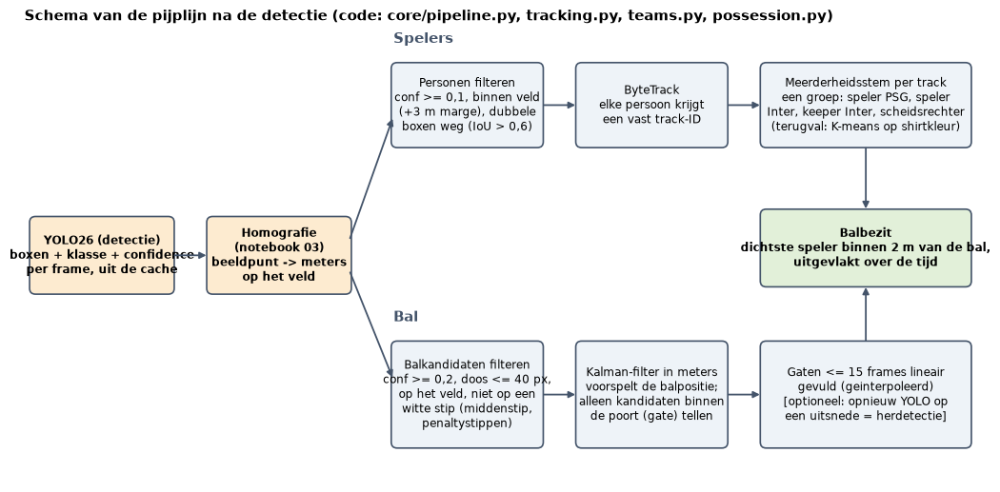
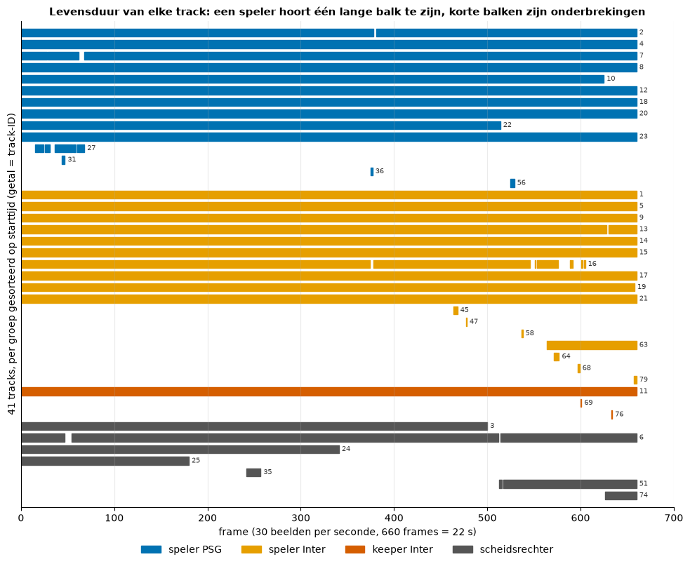
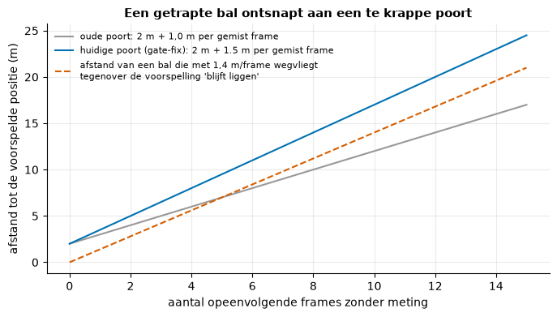
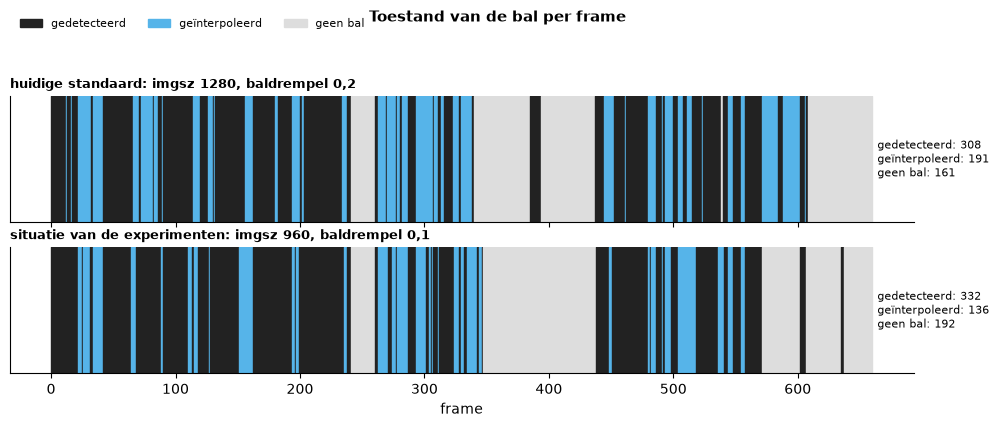
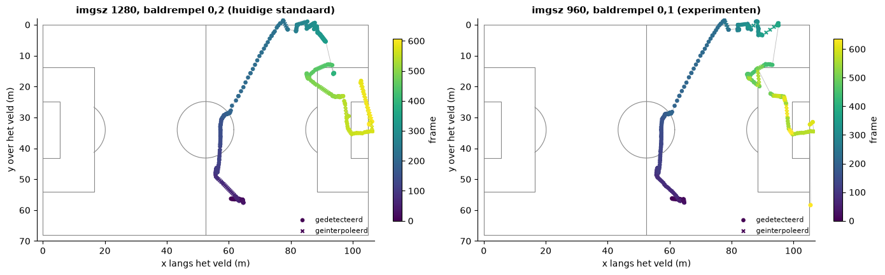
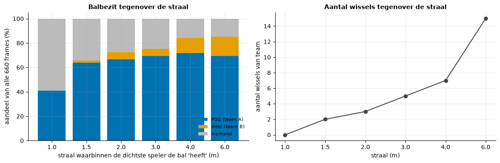

# 06. Tracking, teams, bal en balbezit

Dit bestand legt de technieken uit die na de detectie komen. Het notebook `notebooks/04_tracking_en_balbezit.ipynb` rekent ze door op onze clip (660 frames, 30 beelden per seconde); de code staat in `streamlit/core/` (`tracking.py`, `teams.py`, `possession.py`, `ball_refine.py`, `pipeline.py`).

*Figuur: de stappen na de detectie, van losse boxen per frame tot spelers met een identiteit, een balspoor en balbezit (notebook 04, sectie 1).*

## 1. Van losse boxen naar identiteiten

YOLO bekijkt elk frame afzonderlijk. Dezelfde speler heeft in frame 100 en 101 twee boxen zonder verband, en soms een andere klasse. *Tracking-by-detection* koppelt de boxen van opeenvolgende frames aan elkaar, zodat elke speler een vast nummer (track-ID) krijgt.

### ByteTrack

Wij gebruiken `BYTETracker` uit de bibliotheek ultralytics (Zhang e.a., 2022). Per track houdt hij een Kalman-filter bij en per frame doet hij:

1. **Voorspellen** waar elke bestaande box nu staat (positie plus snelheid).
2. **Eerste ronde:** de voorspelde boxen koppelen aan de *zekere* detecties (confidence >= 0,3). De kost is `1 - IoU` (IoU = overlap gedeeld door vereniging van twee boxen, met de confidence erin verwerkt); een optimale toewijzing (Hongaars algoritme) zoekt de laagste totale kost. Een koppeling met kost boven 0,8 (`MATCH_THRESH`) mag niet.
3. **Tweede ronde:** de overgebleven tracks koppelen aan *zwakke* detecties (confidence 0,1 tot 0,3), alleen op IoU met kost hoogstens 0,5. Dat is het kenmerkende idee van ByteTrack: een speler die half achter een ander staat krijgt een lage confidence, maar verdwijnt daarom niet.
4. **Nieuw en verloren:** een zekere detectie zonder koppeling start een nieuwe track (telt pas mee na bevestiging in het volgende frame). Een track zonder koppeling blijft `TRACK_BUFFER` = 30 frames (1 s) bewaard en kan zijn ID terugkrijgen; daarna vervalt hij.

Voor de tracker filteren we de personen: alleen voeten binnen het veld plus 3 m marge (publiek en bankspelers vallen eraf) en van twee boxen met IoU > 0,6 blijft alleen de zekerste staan.

**Onze getallen.** 41 track-ID's voor 22 spelers en een groep scheidsrechters. Negentien tracks lopen vrijwel de hele clip door (mediane tracklengte 20,2 s), 14 duren minder dan 2 s. De koppeldrempel beïnvloedt het aantal tracks veel meer dan de buffer: 0,8 geeft 41 voor elke buffer tussen 10 en 90 frames, 0,6 geeft 143 en 0,9 geeft 37 tot 39. Zonder koppeling op overlap valt het niet te herstellen: dezelfde box overlapt zichzelf na 1 frame voor mediaan 91 %, na 10 frames voor 49 % en na 30 frames voor 8 %.

*Figuur: elke balk is één track-ID, van zijn eerste tot zijn laatste frame (notebook 04, sectie 2). Negentien tracks lopen vrijwel de hele clip door; de korte balken zijn afgebroken stukken.*

**ID-switches.** Een ID-switch is het moment waarop een track van de ene speler naar een andere overspringt, of waarop één speler na een onderbreking een nieuw ID krijgt. We kunnen ze niet meten: de handgelabelde frames liggen 1 s (lichaam) of 4 s (voeten) uit elkaar en de labels hebben geen betrouwbare identiteit over de tijd (66 en 75 verschillende ID's voor ongeveer 22 personen). Een heuristiek (een track eindigt en een nieuwe van dezelfde groep begint binnen 1,5 s en 4 m) vindt minstens 5 vermoedelijke onderbrekingen. Afstanden en snelheden per track zijn daardoor ondergrenzen.

## 2. Teams en rollen

Het finale model voorspelt de groep zelf: `player_A` (PSG), `player_B` (Inter), `player_B_goal_keeper` en `referee`. Het teamletter volgt uit de klasse: A = PSG, B = Inter (de keeper van Inter hoort bij B), de scheidsrechter hoort bij geen team en kan geen balbezit hebben.

**Een groep per track.** `vote_groups` geeft elke track één groep: de klasse met de hoogste som van confidences over alle frames van de track. Een enkel foutief frame draait het team dus niet om. In onze clip wijkt de klasse per frame in 150 van 15.606 getrackte detecties (0,96 %) af van de gekozen groep; 38 van de 41 tracks hebben alle stemmen voor één groep.

**K-means-terugval.** Een model dat alleen `person` kent (zoals het standaard COCO-model) heeft geen teams. Dan neemt `assign_kmeans` per persoon de gemiddelde kleur van de borstkas in de Lab-kleurruimte (gras eruit gefilterd op tint en verzadiging), verdeelt alle personen met K-means in twee clusters (`team 1`, `team 2`) en geeft een persoon met een kleur die verder dan 2,5 keer de typische afstand van beide centra ligt het label `other`. Het finale model heeft dit niet nodig, dus deze code draait in onze resultaten nooit. Op onze eigen detecties (teamlabels verborgen) plaatst K-means 97,6 % van de spelers in het juiste team, maar scheidsrechter en keeper worden maar half als `other` herkend, en `team 1` viel samen met Inter terwijl de code het als A (PSG) codeert. **Hij is niet getest met een echt COCO-model.**

## 3. De bal

De bal is mediaan 14 pixels groot (een speler 54), en het model is er zelden zeker van: mediane confidence 0,17 (spelers 0,72). Per frame zijn er 0 tot 6 baldetecties, dus er is niets om blind te volgen.

**Kandidaten filteren** (`ball_candidate`): confidence >= 0,2, langste zijde <= 40 px, op het veld (+3 m) en minstens 1 m van de middenstip en de penaltystippen. Van de 922 baldetecties blijven 398 kandidaten over, in 318 frames.

### Kalman-filter

Een Kalman-filter schat een toestand uit onzekere metingen door steeds twee stappen te herhalen. Onze baltrack (`BallKalman`) heeft als toestand `(x, y, vx, vy)` in meters en meters per frame, zodat een snelheid overal op het veld hetzelfde betekent (in pixels zou de bal bij het verre doel veel minder pixels per meter afleggen dan bij het nabije).

- **Voorspellen:** `x' = F x`, de positie schuift een snelheidsstap op; de onzekerheid wordt `P' = F P F^T + Q`. Procesruis `Q` = diag(0,05; 0,05; 0,1; 0,1): de bal kan van snelheid veranderen (trap, stuit).
- **De poort (gate):** alleen kandidaten binnen `BALL_GATE` = 2,0 m plus `BALL_GATE_GROWTH` = 1,5 m per frame zonder meting van de voorspelling tellen mee. De dichtstbijzijnde wint; een witte laars ver weg niet.
- **Corrigeren:** `x = x + K (z - H x)`, met de Kalman-versterking `K` uit de onzekerheid `P` tegenover de meetruis `R` = diag(0,3; 0,3) m² (detectie- plus homografiefout). Een hoge meetruis geeft een kleine `K`: de schatting vertrouwt dan de voorspelling meer dan de meting.
- **Starten en stoppen:** een nieuwe track start op een kandidaat met confidence >= 0,25; na `BALL_MAX_MISSED` = 30 frames zonder meting vervalt hij.

**De gate-fix.** De eerste versie had een poortgroei van 1,0 m per frame en 15 gemiste frames. Bij de trap rond frame 203 ging de bal van stilliggen naar 1,4 tot 2 m per frame; de voorspelling bleef bij de plek van de trap en de bal verliet de poort. Gevolg: de frames 204 tot 218 hadden geen bal terwijl hij gewoon gedetecteerd werd. Nu groeit de poort met 1,5 m per frame, kan de track 30 frames zonder meting blijven bestaan en is er een *herstart*: een zekere kandidaat (>= 0,4) buiten de poort start de track opnieuw als een kandidaat in de volgende 3 frames hem voortzet op hoogstens 1,5 m/frame.

*Figuur: hoe ver een kandidaat van de voorspelling mag liggen, per aantal frames zonder meting (notebook 04, sectie 4). Een bal die na een trap 1,4 m per frame aflegt, viel na enkele frames buiten de oude poort en blijft binnen de huidige.*

**Interpolatie:** een gat tussen twee metingen van hetzelfde segment (geen herstart ertussen) van hoogstens `MAX_BALL_GAP` = 15 frames (0,5 s) wordt lineair opgevuld, in meters. Langere gaten blijven leeg; we verzinnen geen ballen.

**Resultaat** (imgsz 1280, baldrempel 0,2): 308 frames gedetecteerd, 191 geïnterpoleerd, 161 zonder bal. De optionele herdetectie (`ball_refine`: YOLO opnieuw op een uitsnede van 640 px rond de verwachte plek, `imgsz` 320, geen opschaling) is ingebouwd maar staat uit; op de setting van de experimenten voegt ze 1 frame toe.

*Figuur: per frame of de bal gedetecteerd, geïnterpoleerd of afwezig is (notebook 04, sectie 4).*

*Figuur: de baan van de bal in meters op het veld, gekleurd naar framenummer (notebook 04, sectie 4). Links de huidige standaard, rechts de instelling van de bal-experimenten (imgsz 960, baldrempel 0,1).*

## 4. Balbezit

`raw_possession`: de speler van team A of B die het dichtst bij de bal staat (voeten, in meters) heeft de bal als die afstand <= `POSSESSION_RADIUS` = 2,0 m is; anders niemand. `stable_possession` vlakt dat uit: het bezit wisselt pas na `POSSESSION_SWITCH` = 5 opeenvolgende frames van het andere team (*hysterese*) en wordt 'niemand' na `POSSESSION_TIMEOUT` = 15 frames zonder iemand binnen de straal.

**Onze getallen:** PSG 91,9 % en Inter 8,1 % van de 479 frames met balbezit (181 frames zonder bezit, waarvan 161 zonder bal), 3 wissels. De straal en de hysterese zijn keuzes die we niet gemeten hebben: bij 1 m heeft in 59 % van de frames niemand de bal, bij 6 m zijn er 15 wissels; bij een hysterese van 15 frames verdwijnt het Inter-bezit helemaal. Beperking: de homografie plaatst een bal in de lucht op een verkeerde plek op het veld.

*Figuur: het aandeel balbezit en het aantal wissels als functie van de straal (notebook 04, sectie 6). Een kleine straal laat de meeste frames zonder bezit; een grote straal geeft veel wissels.*

## Verder lezen

Notebook 04 toont de grafieken en de gevoeligheidsanalyses (trackerinstellingen, balstraal, baldrempel en gat). De homografie staat in notebook 03, de analyses in notebook 05 en de meting tegen handgelabelde data in notebook 06. De bal-experimenten (`results.md`, `conclusie.md`, `run_experiments.py`) staan in `data/results/bal_experimenten/`.
