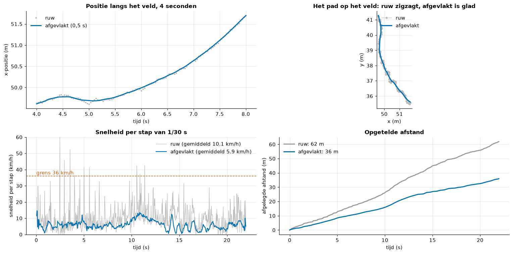
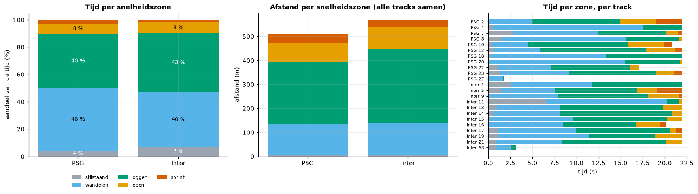
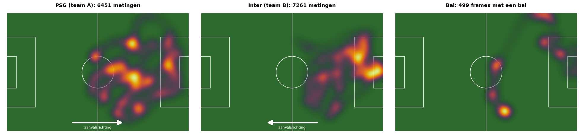
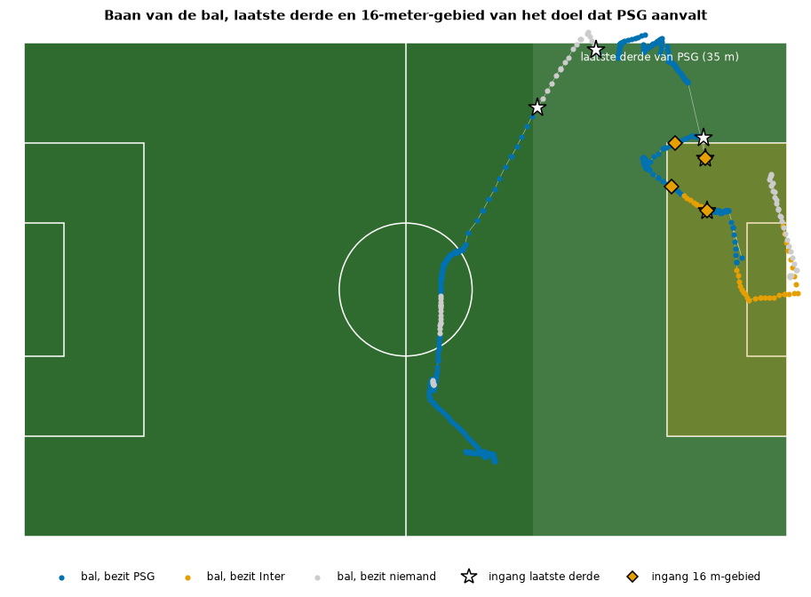
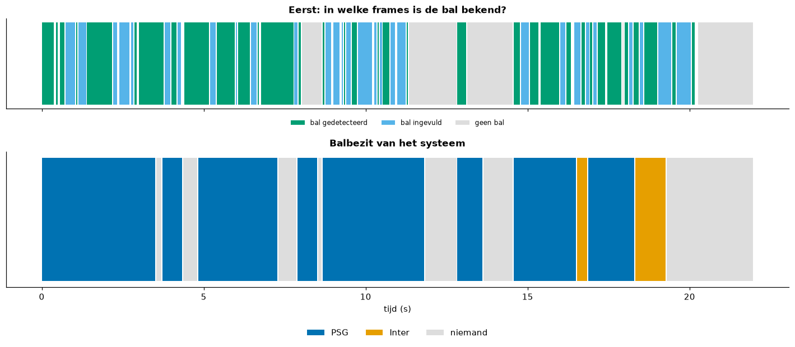

# 07. Wedstrijdanalyse: van tracks naar statistieken

De pijplijn levert posities van spelers en bal in meters op het veld. Dit document legt uit hoe daar afstand,
snelheid, snelheidszones, heatmaps, aanvalsrichting, aanvallen en balbezit uit volgen, en vooral **wat die cijfers wel
en niet kunnen zeggen**. De berekeningen staan in `streamlit/analytics/` en worden stap voor stap uitgevoerd in
`notebooks/05_match_analyse.ipynb`; alle getallen hieronder komen uit dat notebook (resultaatbestanden in
`data/results/analyse/`). De clip is 22 seconden (660 frames, 30 beelden per seconde) en toont PSG (team A) tegen
Inter (team B).

## 1. De invoer: twee tabellen

`core.pipeline.run()` geeft het resultaat terug; het schrijft twee tabellen:

- `tracks`: één rij per gevolgde persoon per frame, met `track_id`, `group` (PSG-speler, Inter-speler, keeper Inter,
  scheidsrechter), `team` en de positie van de voeten `x_m`, `y_m` in meters. Het veld is 105 m lang (x) en 68 m
  breed (y); de oorsprong ligt op de verre zijlijn bij de linker doellijn.
- `frames`: één rij per frame met de balpositie, de status van de bal (`detected`, `interpolated`, `none`) en het
  balbezit.

In deze clip zijn dat 15 606 persoonrijen met 41 verschillende track-id's. Een **track** is niet hetzelfde als een
speler: raakt de tracker een speler kwijt, dan krijgt hij later een nieuw id (een *ID-wissel*). Tracks korter dan
1 s laten we weg; er blijven 29 over (11 PSG, 12 Inter inclusief keeper, 6 scheidsrechters).

## 2. Afvlakken, afstand en snelheid

**Het probleem.** Elke positie is de voet van een detectiebox, omgezet met de homografie. De box beweegt een paar
pixels van frame tot frame, en op het veld wordt dat decimeters. Telt men ruwe stappen op, dan telt de trilling als
"lopen". Voor de speler die we in het notebook tonen, geeft dat 62 m ruwe afstand tegenover 36 m afgevlakt; over alle
gehouden tracks is ruw gemiddeld **59 % te veel**, en de snelheid per stap loopt op tot 60 km/h.

*Figuur: de ruwe en de afgevlakte baan van één speler (notebook 05, sectie 2). De trilling van de ruwe posities telt mee als afgelegde afstand.*

**De oplossing.** Per track en per stuk zonder gat van meer dan `MAX_GAP_S` = 0,5 s nemen we een gecentreerd
voortschrijdend gemiddelde over `SMOOTH_S` = 0,5 s. De afgevlakte positie op tijd t_i is het gemiddelde van de ruwe
posities met |t - t_i| ≤ 0,25 s; aan de rand van een stuk wordt het venster symmetrisch kleiner. Daarna:

- **afstand** = som over stappen van `sqrt(dx² + dy²)` van de afgevlakte posities;
- **gemiddelde snelheid** = afstand / tijd van de stukken, maal 3,6 voor km/h;
- **maximale snelheid** = grootste verplaatsing over minstens 0,5 s (een stap van 1/30 s is te ruw), met een bovengrens
  van `MAX_SPEED_KMH` = 36 km/h; wordt die geraakt, dan markeert de code de track als "afgekapt" (waarschijnlijk een
  meetfout). In deze clip raakt geen enkele track de grens; de hoogste waarde is 31,2 km/h.

Het venster is een compromis. De totale afstand van alle tracks daalt van 1904 m (ruw) naar 1199 m (0,5 s) en 1097 m
(2 s). Na 0,5 s zakt de curve nog maar langzaam: groter afvlakken haalt trilling weg maar snijdt ook echte bochten af.
Ook de afgevlakte afstanden blijven dus een **schatting**.

**Resultaat.** Een veldspeler die de hele clip gevolgd wordt, legt 36 tot 79 m af (gemiddeld 6 tot 13 km/h). Per
track: PSG 46,5 m en 8,1 km/h, Inter 47,5 m en 8,3 km/h. Het teamtotaal is 511,5 m (PSG) en 569,6 m (Inter), maar dat
verschil komt van het aantal tracks (11 tegenover 12) en niet van het tempo.

## 3. Snelheidszones en sprints

Elke stap tussen twee afgevlakte posities krijgt een snelheid (verplaatsing over een span van 0,5 s rond de stap); tijd
en afstand worden bij de bijbehorende zone opgeteld. De grenzen (in `analytics/zones.py`) zijn gangbare, geen
officiële drempels:

| Zone | Snelheid |
|---|---|
| stilstaand | < 2 km/h |
| wandelen | 2 tot 7 km/h |
| joggen | 7 tot 15 km/h |
| lopen | 15 tot 20 km/h |
| sprint | ≥ 20 km/h |

Een **sprint** is minstens 1 s aaneengesloten boven 20 km/h. Resultaat: PSG 46 % wandelen, 40 % joggen, 8 % lopen,
3 % sprinten; Inter 40 %, 43 %, 8 %, 2 %. Elk team heeft 2 sprints (PSG-track 2 piekt op 31,2 km/h, Inter-track 5 op
23,0 km/h). De verschillen tussen de teams zijn kleiner dan 6 procentpunt; met 11 en 12 tracks en 22 seconden zijn
dat geen aanwijzingen.

*Figuur: het aandeel van de tijd per snelheidszone, per team (notebook 05, sectie 3).*

## 4. Kilometers en de extrapolatie

De kilometers per team zijn de som over de gehouden tracks: 0,511 km (PSG) en 0,570 km (Inter). Dat is een
**ondergrens**: een ID-wissel splitst een speler over meerdere tracks, korte tracks vallen weg en een speler telt alleen
mee zolang hij in beeld en getrackt is. De code rekent ook "kilometers per 90 minuten" uit, maar dat is niet meer dan
het gemiddelde tempo maal 1,5 uur (8,1 km/h x 1,5 = 12,2 km). Het is **indicatief**: het gemiddelde tempo per vak
van 4 s loopt in de clip van 5,4 tot 12,7 km/h, dus opschalen geeft 8 tot 19 km. De 12,2 en 12,4 km zijn een
toevalstreffer (ze lijken op een echte wedstrijd), geen meting. Een wedstrijd heeft rustfasen en wissels die in 22 s niet
voorkomen.

## 5. Heatmaps en gemiddelde posities

Een **heatmap** telt de afgevlakte posities in vakken van 1 m x 1 m, maakt het raster vloeiend met een gaussiaans filter
(sigma = 2,5 m) en kleurt het (lichter = vaker). Zo maken we er een per team en een van de bal. Het zwaartepunt ligt voor
PSG op x = 74,9 m, voor Inter op 82,8 m en voor de bal op 76,1 m: het spel speelt zich in het rechterdeel af. De
**gemiddelde positie** is per track het gemiddelde van (x, y); voor PSG liggen de voorste tracks op x = 84 tot 86 m,
voor Inter de veldspelers tussen 69 en 89 m en de keeper op 100,9 m. Het is een momentopname van 22 s, geen formatie.

*Figuur: waar PSG, Inter en de bal zich in de clip bevonden, met de aanvalsrichting als pijl (notebook 05, sectie 4). Het spel speelt zich in de rechterhelft af.*

## 6. Aanvalsrichting en aanvallen

De clip zegt niet welk doel PSG aanvalt. De code stemt met drie signalen, elk +1 (PSG valt rechts aan), -1 (links) of 0
(geen uitspraak):

1. **Keepers** (gewicht 2): een keeper staat bij het doel dat hij verdedigt. De keeper van Inter staat gemiddeld op
   x = 100,9 m (meer dan 10 m van de middenlijn), dus Inter verdedigt rechts en PSG valt rechts aan.
2. **Gemiddelde x van de veldspelers** (gewicht 1, zwak): een team staat meer op de eigen helft. PSG 74,9 m, Inter
   81,4 m (verschil minstens 2 m nodig).
3. **Balbeweging onder bezit** (gewicht 1): onder bezit van PSG verplaatst de bal zich netto +18,8 m in x, onder Inter
   +9,3 m (minstens 3 m nodig).

De gewogen som beslist; de betrouwbaarheid is *hoog* als minstens twee signalen meedoen en alle gelijk wijzen. Hier:
PSG valt aan richting het rechter doel (x = 105), betrouwbaarheid **hoog** (3 van 3 signalen).

Met die richting telt de code per team:

- een **balbezitfase**: aaneengesloten bezit, onderbroken door de andere ploeg of door meer dan 15 frames zonder bezit;
- een **ingang in het laatste derde**: de bal komt binnen 35 m van de aangevallen doellijn;
- een **aanval**: een fase met minstens één zo'n ingang;
- een **ingang in het 16-meter-gebied**: de bal komt binnen 16,5 m van de doellijn en tussen y = 13,8 en 54,2 m.

Uitkomst: PSG 5 fasen, 5 ingangen in het laatste derde (dus 5 aanvallen) en 4 ingangen in het 16-meter-gebied (frames
385, 448, 492 en 506). Inter heeft 2 fasen van 0,3 en 1 s vlak bij het eigen doel en geen enkele ingang. De tegenproef laat
zien hoe afhankelijk dit is van de richting: bij omgekeerde richting krijgt PSG 0 en Inter 2 ingangen. Schoten worden
niet geteld: ze zijn in deze data niet betrouwbaar van een pass te onderscheiden.

*Figuur: de baan van de bal, gekleurd naar balbezit, met de ingangen in het laatste derde (ster) en in het 16-meter-gebied (ruit) (notebook 05, sectie 5).*

## 7. Balbezit

Per frame heeft het team van de **dichtstbijzijnde speler binnen 2 m van de bal** de bal (scheidsrechters tellen niet). Een
wissel gebeurt pas als de andere ploeg 5 frames achtereen de bal heeft, en bezit vervalt na 15 frames zonder speler
bij de bal. In 479 van de 660 frames heeft iemand de bal: PSG 92 %, Inter 8 %, met 3 wissels. In 161 frames is er geen bal
bekend, en daar kan geen bezit worden toegekend; dat treft vooral de laatste seconden en de drukke momenten.

*Figuur: boven de frames waarin de bal bekend is, onder het balbezit per moment in de clip (notebook 05, sectie 6). Zonder bal kan er geen bezit zijn.*

## 8. Wat de uitspraken wel en niet dragen

- **Veilig**: PSG heeft de bal en komt vijf keer in het laatste derde van Inter; beide teams leggen per speler
  ongeveer evenveel af; ruwe posities overschatten de afstand sterk.
- **Voorzichtig**: de exacte percentages (balbezit), absolute afstanden en snelheden (ondergrens, afgevlakt met een
  gekozen venster), het aantal aanvallen (afhankelijk van de baltrack), de zones en sprintgrens (conventies).
- **Niet te zeggen**: kilometers per wedstrijd, formaties, schoten, of dit voor de wedstrijd als geheel geldt.
- **Oorzaken van onzekerheid**: homografieruis (de keyframes zelf hebben een reprojectiefout van 0,07 tot 0,28 m,
  mediaan 0,16 m, de posities van spelers wijken ongeveer 1 m van geklikte voeten af, zie `08_systeemevaluatie.md`);
  ID-wissels (41 id's voor 22 spelers en scheidsrechters, een PSG-speler die als scheidsrechter telt, 8 in plaats van
  10 gevolgde PSG-veldspelers aan het eind); één korte clip; een bal die in 24 % van de frames ontbreekt.
