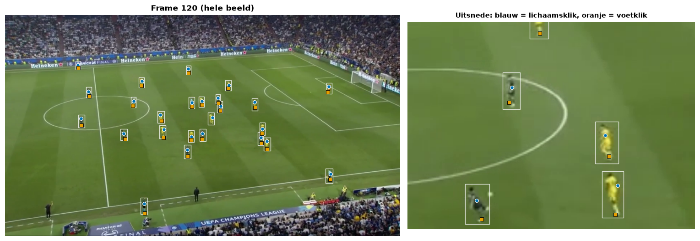
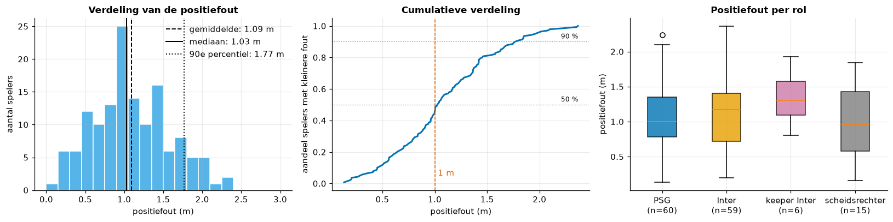
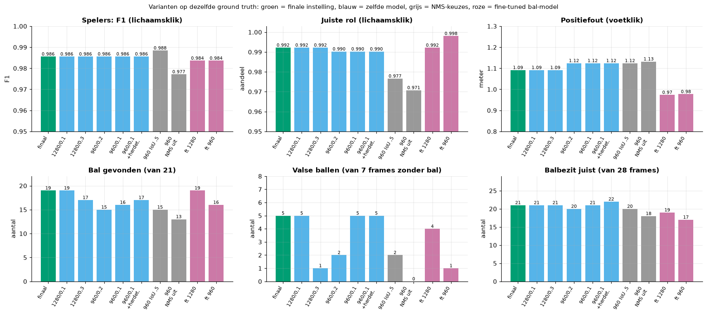
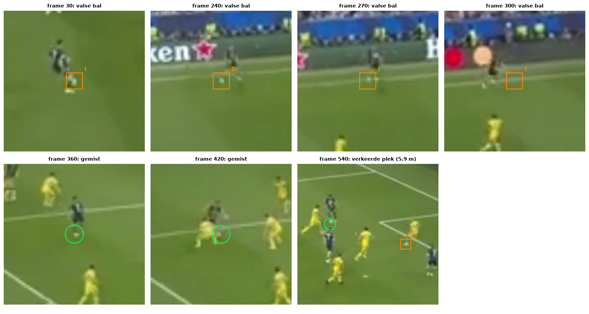
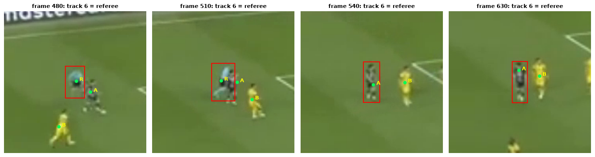

# 08. Systeemevaluatie: het hele systeem tegen eigen ground truth

De mAP van het detectiemodel (zie `03_evaluatie_metrics.md`) zegt hoe goed de boxen op losse afbeeldingen kloppen. Ons
eindproduct is iets anders: een minimap met spelers, bal en balbezit. Dit document legt uit waarom we het hele systeem
apart meten, hoe, wat eruit kwam en waar het misgaat. Alles wordt uitgevoerd in
`notebooks/06_systeemevaluatie.ipynb` (code in `streamlit/evaluation/`, resultaatbestanden in `data/results/evaluatie/`).

## 1. Waarom een systeemevaluatie naast de mAP?

De mAP meet detectie per afbeelding. Het meet niet of de homografie de voeten op de juiste plaats van het veld zet, of
een speler zijn track-id behoudt, of de baltracker bij valse ballen blijft hangen en of het balbezit klopt. Fouten kunnen
elkaar versterken (een goede box met een slechte homografie geeft een verkeerde positie) of verbergen (een gemiste bal
die de tracker toch invult). Daarom meten we op het **eindresultaat**, tegen met de hand gelabelde waarheid.

## 2. De ground truth

Met de labeltool `streamlit/label_ground_truth.py` heeft een teamlid (Kobe) per frame elke persoon aangeklikt (rol A = PSG,
B = Inter, K = keeper Inter, R = scheidsrechter), de bal aangeklikt of als "niet zichtbaar" gemarkeerd en het balbezit
gekozen. De tool zet de klik meteen om naar meters met dezelfde homografie als de pijplijn. Er zijn twee sessies:

| Bestand | Frames | Klik |
|---|---|---|
| `data/ground_truth.json` | 22 (elk 30e frame: 0, 30, ..., 630) | op het **lichaam** (516 personen, 17 ballen, 5 zonder bal) |
| `data/ground_truth_feet.json` | 6 (0, 120, 240, 360, 480, 600) | op de **voeten** (140 personen, 4 ballen, 2 zonder bal) |

Waarom twee? De homografie beschrijft het **grasvlak**; een klik op de romp ligt ongeveer een meter boven dat vlak en
komt op het veld meters verder uit. We meten dat: de mediane klik ligt op 0,40 van de boxhoogte (lichaam) tegenover
0,84 (voeten), en een lichaamsklik ligt na omzetting gemiddeld 3,9 m van de voetpositie van het systeem tegenover 1,09 m
bij een voetklik. Daarom heeft de evaluatiecode twee ankers: bij een **voetklik** vergelijkt ze in meters (de echte
positiefout), bij een **lichaamsklik** in pixels (afstand van de klik tot het midden van de box, gedeeld door de
boxhoogte, straal 0,6). Detectie, rol en balbezit blijven dan meetbaar; een positiefout in meters niet.

*Figuur: een frame met de handmatige klikken (notebook 06, sectie 1). Een klik op de romp ligt enkele tientallen pixels boven een klik op de voeten; na projectie naar het veld is dat meters.*

## 3. De metrics

- **Personen gevonden.** Het Hongaarse algoritme koppelt elke aangeklikte persoon aan hoogstens één box (minimale totale
  afstand); een koppeling verder dan de matchstraal telt niet. TP = gekoppeld, FN = aangeklikt zonder box, FP = box zonder
  klik; precisie = TP/(TP+FP), recall = TP/(TP+FN), F1 = 2TP/(2TP+FP+FN). Straal: 3 m (voeten) of 0,6 boxhoogte (lichaam).
- **Juiste rol**: aandeel gekoppelde spelers met dezelfde rol als aangeklikt.
- **Positiefout (m)**: afstand voetklik - voetpositie (midden onderrand van de box) van het systeem; we tonen de verdeling.
- **Bal gevonden / balfout / valse bal**: een frame met zichtbare bal telt als gevonden als het systeem een bal heeft (ook
  een door de tracker ingevulde bal); de fout is de afstand in meters; boven 3 m is de bal "op de verkeerde plek". Een valse bal is
  een bal in een frame waarin de labelaar "niet zichtbaar" koos.
- **Balbezit juist**: aandeel frames waarin het balbezit van het systeem gelijk is aan het gelabelde.
- **ID-wissels**: de code kan ze tellen, maar met frames die 1 s uit elkaar liggen is het geen betrouwbare maat (zie
  beperkingen).

## 4. De resultaten (finale model, `imgsz` 1280, baldrempel 0,2)

| Maat | Lichaamsklik (22 frames) | Voetklik (6 frames) |
|---|---|---|
| Personen TP / FP / FN | 512 / 11 / 4 | 140 / 3 / 0 |
| Precisie / recall / F1 | 0,979 / 0,992 / **0,986** | 0,979 / 1,000 / **0,989** |
| Juiste rol | 99,2 % | 99,3 % |
| Positiefout (m) | n.v.t. | gemiddeld **1,09**, mediaan 1,03, p90 1,77 |
| Bal: gevonden / valse bal | 15 van 17 / 4 van 5 | 4 van 4 / 1 van 2 |
| Balfout (m) | gemiddeld 0,74, mediaan 0,26 | gemiddeld 0,48, mediaan 0,17 |
| Balbezit juist | 17 van 22 (0,77) | 4 van 6 (0,67) |

Samen: **19 van 21 ballen** gevonden (18 binnen 3 m), **5 van 7** frames zonder bal krijgen toch een bal, balbezit 21 van 28.

Twee kanttekeningen bij de cijfers:

- **F1 hangt van de matchstraal af.** Bij de lichaamsklik is F1 stabiel vanaf 0,4 boxhoogte. Bij de voetklik is dat niet zo:
  bij een straal van 1 m wordt maar 45 % van de spelers gekoppeld (F1 0,45), bij 2 m is F1 0,95, vanaf 3 m 0,989. "F1 0,99"
  betekent dus: gevonden binnen 3 m. De nauwkeurigheid staat in de positiefout.
- **De positiefout is grotendeels systematisch.** Het systeem plaatst de voeten gemiddeld 1,00 m dichter bij de camera
  dan geklikt; na aftrek van die verschuiving blijft 0,48 m over. Een deel is een definitiekwestie (box-onderrand tegenover
  voetklik). De fout is groter aan de verre zijlijn (1,35 m tegenover 0,77 m aan de dichtbije kant), omdat een pixel daar
  22 cm beslaat tegenover 4 cm vlakbij.

*Figuur: de verdeling van de positiefout van 140 spelers op de 6 voetframes (notebook 06, sectie 2). Bijna de helft ligt binnen 1 m, 96 % binnen 2 m.*

**Het balbezit is nauwelijks te beoordelen.** In alle 28 gelabelde frames is het bezit "PSG". Een systeem dat altijd
"PSG" zegt zou dus 28 van 28 halen, terwijl het systeem er 21 haalt. De maat toetst alleen het missen van PSG-bezit, niet het
onderscheid tussen de teams.

## 5. Varianten op dezelfde ground truth

Alleen combinaties waarvan de YOLO-detecties in de cache staan, zodat er geen nieuwe YOLO-run nodig was.

| Variant | Spelers F1 | Positiefout (m) | Bal gevonden (van 21) | Valse bal (van 7) | Balbezit (van 28) |
|---|---|---|---|---|---|
| **finaal: 1280, drempel 0,2** | 0,986 | 1,09 | **19** | 5 | 21 |
| 1280, drempel 0,3 | 0,986 | 1,09 | 17 | 1 | 21 |
| 960, drempel 0,2 | 0,986 | 1,12 | 15 | 2 | 20 |
| 960, drempel 0,1 | 0,986 | 1,12 | 16 | 5 | 21 |
| 960, drempel 0,1 + herdetectie | 0,986 | 1,12 | 17 | 5 | 22 |
| 960, IoU 0,5 | 0,988 | 1,12 | 15 | 2 | 20 |
| 960, NMS uit | 0,977 | 1,13 | 13 | 0 | 18 |
| fine-tuned bal-model, 1280 | 0,984 | 0,97 | 19 | 4 | 19 |

De spelers veranderen nauwelijks (F1 0,977 tot 0,988). De bal wel: 1280 vindt 19 ballen, 960 vindt er 15 of 16. De baldrempel 0,2 is
de hoogste waarbij nog alle 19 ballen gevonden worden; hoger geeft minder valse ballen maar ook gemiste. Herdetectie
(`ball_refine`) vergelijken we alleen op 960 met drempel 0,1: alleen daarvoor zitten alle uitsneden in de cache (bij 1280 ontbreken
er 156). Het fine-tuned bal-model is een mislukt experiment en is niet beter dan het finale model.

*Figuur: alle varianten op dezelfde ground truth (notebook 06, sectie 4). De spelerscijfers blijven gelijk; de bal reageert op beeldgrootte en drempel.*

Eerdere projectnotities noemden een spelers-F1 van 0,99 en 19 van 21 gevonden ballen; die cijfers vinden we hier terug (F1 0,986 tot 0,989). Twee andere cijfers uit die notities kloppen niet voor het finale model. De juiste rol is 99,2 tot 99,3 % en niet 99,6 tot 100 % (die waarde vinden we alleen bij het fine-tuned bal-model). En de gemiddelde positiefout van spelers is 1,09 m; 0,5 m is de balfout op de voetset (0,48 m) en de spelersfout na aftrek van de systematische verschuiving.

## 6. Foutenanalyse

**Bal (7 problemen).** Frame 360 en 420: de bal (enkele pixels, onscherp tussen spelers) is **niet gedetecteerd** (geen enkele
baldetectie vanaf zekerheid 0,05 binnen 130 pixels): een beperking van de detector. Frame 540: een detectie met zekerheid 0,51 op een wit vlekje bij een
Inter-speler, 5,9 m van de echte bal: een valse positief die de drempel niet weert. Frames 30, 240, 270 en 300 ("geen bal zichtbaar"):
het systeem geeft toch een bal, drie keer ingevuld door de tracker en eenmaal door een zwakke detectie (zekerheid 0,26). Bij 30, 240 en 270 is
op die plek een wit vlekje te zien; "niet zichtbaar" in de labels betekent daarom niet "niet aanwezig".

*Figuur: uitsneden van de frames waar de bal gemist, verkeerd geplaatst of onterecht gemeld is (notebook 06, sectie 5.2).*

**Spelers (4 FN, 11 + 3 FP).** Drie van de vier gemiste personen zijn de scheids- of grensrechter op de zijlijn: gezien (zekerheid 0,63 tot
0,80) maar buiten veld plus 3 m marge, dus bewust weggefilterd. De vierde is samengevoegd met een overlappende box. De extra boxen
zijn 5 dubbele boxen op één speler, 4 niet-gelabelde personen aan de rand en 5 naast een klik bij overlappende spelers.

**Rol (5 fouten = 1 speler).** Alle vijf hebben track-id 6: de scheidsrechter. Vanaf ongeveer frame 510 gaat die track een PSG-speler volgen
(ID-wissel na een overlap), maar de groep wordt per track bepaald (meerderheidsstem), dus de speler blijft "scheidsrechter". De detector zelf heeft hem juist
geclassificeerd: het is een tracking-probleem. Herstel: de groep per frame bepalen of een track splitsen bij een klassewissel.

*Figuur: track 6 volgt eerst de scheidsrechter en springt rond frame 510 over op een PSG-speler, die daardoor als scheidsrechter blijft tellen (notebook 06, sectie 5.3).*

**Balbezit (7 fouten).** Frames 360, 420, 630: geen bal, dus geen bezit. Frames 570 en 600: de bal ligt 4,5 tot 4,8 m van de dichtstbijzijnde
speler (Inter), buiten de straal van 2 m. Het is dus geen aparte fout van de regel, maar het gevolg van ontbrekende ballen.

## 7. Conclusie en beperkingen

Het systeem vindt spelers en hun rol bijna foutloos, plaatst ze op ongeveer 1 m nauwkeurig (voor een deel een systematische verschuiving)
en vindt de bal in 19 van 21 gelabelde frames, met de bal als zwak punt: gemiste kleine ballen, een valse positief en ingevulde ballen op frames waar de bal weg is.
Beperkingen: weinig frames (28, waarvan 21 met bal en 7 zonder: één frame is 5 tot 14 procentpunt); de labelaar is ook de bouwer en de
instellingen zijn op dezelfde ballen gekozen als waarop we beoordelen, dus 19/21 is optimistisch; de labels zijn niet foutloos (frame 360 is tegenstrijdig, ook staan er personen niet in);
twee sessies met twee ankers; balbezit alleen PSG gelabeld; ID-wissels niet meetbaar (71 wissels bij 66 personen in de lichaamsset zegt vooral iets over de afstand van 1 s tussen de frames); één korte clip van 22 s.
