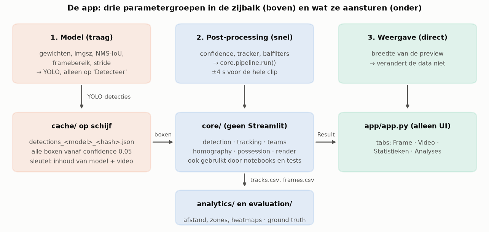
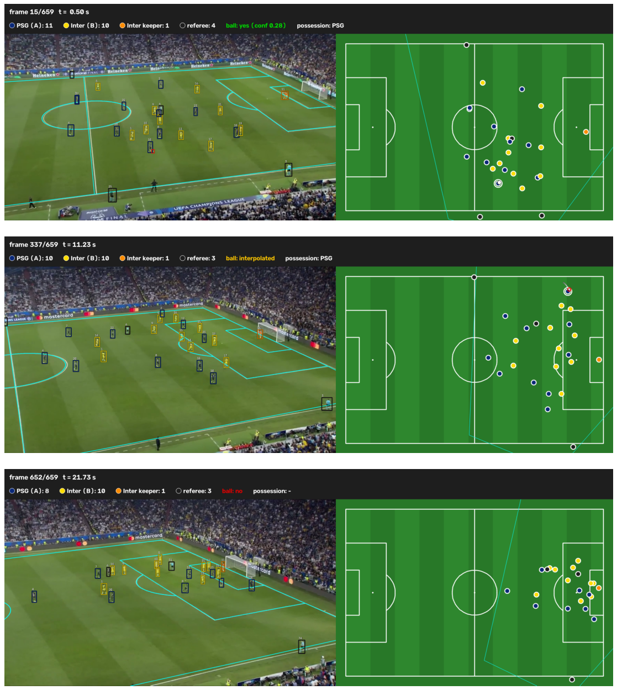

# 09. De Streamlit-app

De app in `streamlit/` is het eindproduct van het project: iemand die geen programmeur is kan een clip kiezen, de
instellingen van het model en de nabewerking aanpassen en meteen zien wat dat doet met de detecties, de minimap en
de statistieken. Deze uitleg beschrijft hoe de app is opgebouwd en waarom, geeft een rondleiding door de tabs en
legt uit hoe ze samenhangt met de notebooks. Installatie en gebruik staan in `streamlit/README.md`.

## 1. Architectuur: UI en logica gescheiden

De app bestaat uit twee lagen.

- `streamlit/app/app.py` is alleen gebruikersinterface: een zijbalk met widgets, vier tabs, en wat caching van
  resultaten. Er zit geen rekenwerk in dat bij het project zelf hoort.
- `streamlit/core/` bevat de hele keten als gewone Python-functies zonder Streamlit-afhankelijkheid:
  `video` (frames lezen), `detection` (YOLO), `teams` (klasse en jersey-kleur), `tracking` (ByteTrack voor spelers,
  een Kalman-filter voor de bal), `homography` (pixels naar veldmeters), `pitch` (veldmodel), `possession`
  (balbezit), `ball_refine` (de bal zoeken in uitsneden) en `render` (tekenen van beeld en minimap).
  `core/pipeline.py` verbindt die stappen in één functie, `run()`, die een `Result` teruggeeft.
- `streamlit/analytics/` (afstand, snelheid, zones, kilometers, aanvalsrichting, heatmaps) en
  `streamlit/evaluation/` (vergelijking met de ground truth) werken op de csv-tabellen die `run()` oplevert.

Waarom die scheiding? Dezelfde `run()` wordt gebruikt door de app, door de scripts (`run_all.py`,
`run_minimap.py`), door de tests en door de notebooks. Wat je in een notebook uitrekent is dus letterlijk wat de
app toont, en de tests (77 stuks) kunnen de logica controleren zonder een browser te starten. De app roept alleen
`core` aan en tekent de uitkomst.

*Figuur: de drie parametergroepen van de zijbalk en de onderdelen die ze aansturen. Alleen de detectie (links) is traag en wordt op schijf bewaard.*

Alle paden staan in `core/paths.py` en worden berekend vanaf dat bestand (`final_upload/` is de wortel). Daardoor
werkt de map na kopiëren naar een andere computer, en start de app vanuit elke werkmap.

## 2. De drie parametergroepen

De zijbalk is ingedeeld naar wat er opnieuw moet gebeuren als je een waarde wijzigt. Dat bepaalt of het snel is
of niet.

1. **Model** (gewichten, imgsz, NMS-IoU, framebereik, stride). Deze waarden veranderen wat YOLO ziet, dus er is
   een nieuwe detectie nodig. Dat is het trage deel en het start alleen na een klik op **Detecteer**.
2. **Post-processing** (confidence van spelers en bal, trackerinstellingen, balfilters, optionele herdetectie in
   uitsneden). Deze waarden werken in op de boxen die YOLO al gaf: filteren op confidence, tracks koppelen,
   de bal volgen en invullen, posities omrekenen naar meters, balbezit bepalen. Dat is licht rekenwerk.
3. **Weergave** (breedte van de preview). Verandert niets aan de data.

### Waarom detectie gecachet wordt en post-processing niet

YOLO draait één keer per combinatie van groep 1, bij een lage drempel (confidence 0,05), en bewaart *alle* boxen met
hun confidence en jerseykleur. De "echte" confidence-drempels (0,3 voor spelers, 0,2 voor de bal) worden pas
daarna toegepast. Eén detectie kan dus voor veel verschillende drempels en trackerinstellingen dienen. De nabewerking
van de hele clip duurt ongeveer 4 s uit de cache; het opslaan van het resultaat zou meer moeite kosten dan het
opnieuw uitrekenen, en een cache van de nabewerking zou elke combinatie van een tiental schuifjes moeten
onthouden. Daarom wordt alleen de dure stap op schijf bewaard.

De ballen die YOLO in een uitsnede opnieuw zoekt ("herdetectie") zijn ook een YOLO-stap. Ze krijgen daarom een
eigen cache en een eigen knop, en de app start ze nooit stilletjes.

Binnen een sessie gebruikt de app daarnaast Streamlit's eigen geheugencache (`st.cache_resource` voor het model en
het resultaat, `st.cache_data` voor losse beelden en analyses), zodat het verschuiven van de frame-schuif niets
opnieuw berekent.

### De caching op schijf met een draagbare sleutel

Elke detectie wordt bewaard als een json-bestand in `streamlit/cache/`. De bestandsnaam is
`detections_<model>_<imgsz>_<sleutel>.json`, waarbij de sleutel een hash is van:

- het model: bestandsnaam, grootte in bytes en md5 van de inhoud;
- de video: op dezelfde manier;
- de parameters: imgsz, IoU, begin- en eindframe, stride, detectie-confidence (en de NMS-instelling als die afwijkt).

Er zitten bewust geen absolute paden of wijzigingstijdstippen in. Een eerdere versie gebruikte die wel, en dan was
elke cache waardeloos zodra de map naar een andere computer verhuisde of het model opnieuw gekopieerd werd. Met de
inhoudshash geldt het omgekeerde: een gekopieerde map hergebruikt zijn cache (dat is hoe de detecties uit de
GPU-run op deze laptop terechtkwamen), terwijl een hertraind model met dezelfde bestandsnaam een andere hash krijgt
en dus niet per ongeluk oude detecties gebruikt. Voor caches uit de oude indeling zoekt de code nog het oude
sleutelformaat op.

In `cache/` staan nu de detecties van de hele clip (660 frames) voor het finale model bij imgsz 1280 en IoU 0,7 (de
standaard van de app), imgsz 960 met IoU 0,7, imgsz 960 met IoU 0,5 en imgsz 960 zonder NMS, plus detecties voor het
experimentele `best_ball_ft.pt`. Daardoor kan een laptop zonder GPU toch met de belangrijkste instellingen spelen.

## 3. Rondleiding door de tabs

Bij het opstarten staat de app op het finale model, de hele clip en imgsz 1280. De pagina opent dan met de cijfers
van 660 frames, 41 tracks en balbezit van 92 % voor PSG tegenover 8 % voor Inter.

**Frame.** Een schuif langs alle verwerkte frames. Per frame zie je de camerabeelden met de gedetecteerde boxen,
de track-ID's en de veldlijnen die met de homografie op het beeld teruggeprojecteerd zijn, naast de 2D-minimap
met de spelers per team (PSG donkerblauw, Inter geel), de bal met een spoor van de laatste 20 frames en het
balbezit tot dat frame. Dit is de snelste manier om te zien of een instelling iets stuk maakt: een speler die
plotseling een ander ID krijgt of een bal die in een reclamebord blijft hangen is meteen zichtbaar.

*Figuur: een frame met detecties naast de minimap, zoals de tab Frame ze naast elkaar toont (figuur gemaakt in notebook 03 met dezelfde code; geen schermafbeelding van de app).*

**Video.** Dezelfde weergave als bewegend beeld. De knop "Render video" schrijft een H.264-mp4 naar `output/` en toont
hem in de pagina met een downloadknop. De bestandsnaam bevat een hash van de parameters, dus dezelfde instellingen
renderen niet opnieuw.

**Statistieken.** Het aantal frames en tracks en het percentage frames met een gedetecteerde bal (47 % bij de
standaardinstellingen, met interpolatie 76 %), het balbezit per team en twee downloads: `tracks.csv` (per speler per
frame) en `frames.csv` (bal en balbezit per frame). Daaronder een tabel met alle gebruikte parameters, zodat een
resultaat later reproduceerbaar is.

**Analyses.** De afgeleide cijfers: de aanvalsrichting per team (een stemming van drie signalen: positie van de
keeper, gemiddelde positie en balrichting), het aantal aanvallen en ingangen van het laatste derde en het
16 m-gebied, tijd per snelheidszone en sprints per team, afgelegde kilometers (als ondergrens) en een heatmap per
team met de aanvalsrichting als pijl. Alles wordt uit de csv-bytes van het huidige resultaat berekend en gecachet.
Bij een kort framebereik zijn de cijfers zeer grof; de app zegt dat ook.

## 4. Hoe de app samenhangt met de notebooks

- De notebooks laden `core`, `analytics` en `evaluation` uit `streamlit/` en roepen `pipeline.run()` aan op de
  gecachete detecties. De getallen in de notebooks komen dus uit dezelfde code en dezelfde cache als wat de app toont.
- De scripts `run_all.py` en `run_minimap.py` schrijven de csv's, het rapport en de minimapvideo naar
  `streamlit/output/`. Die bestanden zijn het datacontract tussen de stappen: een notebook of een andere tool hoeft
  alleen `tracks_<model>.csv` en `frames_<model>.csv` te lezen (kolommen: zie `streamlit/README.md`).
- De bestanden `data/keypoints.json` (veldpunten voor de homografie) en `data/ground_truth*.json` (handmatig geklikte
  spelers en bal) zijn invoer voor zowel de app als de evaluatie in de notebooks.
- Het trainen van het model gebeurt niet in de app. De app gebruikt het resultaat ervan, `models/psg_vs_inter_CV.pt`;
  de training staat in notebook 01 en de afstelling in notebook 02.

## 5. Beperkingen

- De homografie is voor één clip aangeklikt; een andere video geeft een niet-kloppende minimap.
- Detectie van nieuwe instellingen op de hele clip is op een CPU traag; de app helpt daarbij met een framebereik en
  stride, en met de cache voor de belangrijkste instellingen.
- De uitkomsten zijn voor één clip van 22 s. De evaluatie gebruikt 22 frames (lichaam geklikt) en 6 frames (voeten
  geklikt), dus balbezit (0,77 en 0,67 juist) is met grote onzekerheid omgeven. De tracker geeft 41 track-ID's voor 22 spelers en de
  scheidsrechters; een speler kan dus over meerdere tracks verdeeld zijn, waardoor kilometers een ondergrens zijn.
- De app is getest zonder browser met `streamlit.testing.v1.AppTest` (starten, model wisselen, drempels wijzigen,
  een niet-gecachete combinatie kiezen) en door de server headless te starten; de visuele indeling is niet in een
  browser gecontroleerd.
